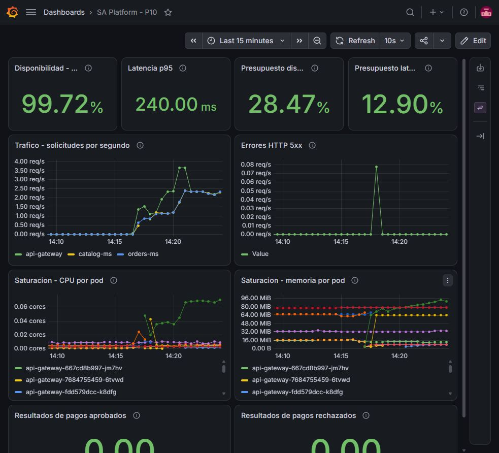
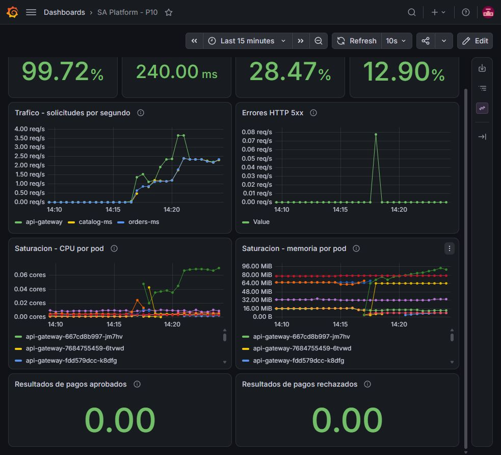
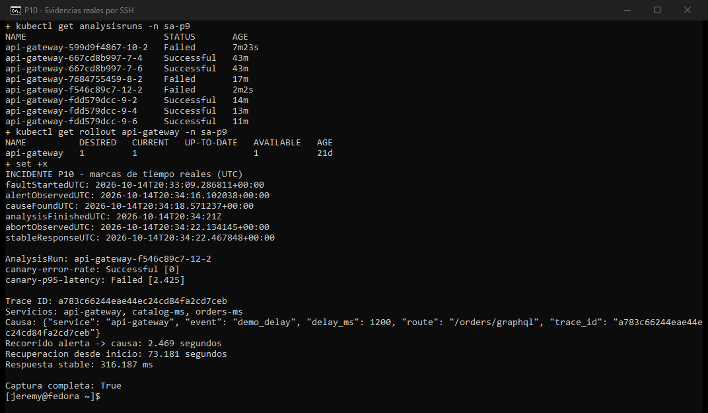

# Practica 10: Observabilidad y operacion

P10 agrega metricas, trazas y logs a la plataforma de P9. Se reutilizan los
servicios de P4 y el cluster creado con Terraform en P9; no se copian dentro
de P10. El cluster se llama `p9-202300644`, en `sa-202300644`, zona
`us-central1-a`. Los servicios trabajan en `sa-p9`.

## Flujo

Solicitud de carrito -> api-gateway -> orders-ms -> catalog-ms.

Los tres servicios propagan `traceparent` y registran el mismo `trace_id`.
Prometheus recoge /metrics. OpenTelemetry Collector envia trazas a Tempo.
Alloy envia logs a Loki. Grafana consulta esos tres almacenes.
Argo Rollouts consulta Prometheus para decidir la promocion.
El gateway se recoge una sola vez por pod mediante PodMonitor; el analisis
identifica la candidata por su hash, sin duplicar stable y canary.
Las alertas llegan a Alertmanager y enlazan a su runbook.

El recorrido completo se muestra en el [diagrama de telemetria](docs/DIAGRAMA.md).
No todas las solicitudes recorren los tres servicios: una consulta directa
al catalogo pasa solo por gateway y catalogo. El Collector recibe trazas;
Prometheus recoge metricas mediante PodMonitor para el gateway y
ServiceMonitor para pedidos y catalogo.

## Tabla de entrega - seccion 4.1

| Item | Enlace o dato |
|---|---|
| Repositorio de codigo | [Practicas-SA-B-202300644](https://github.com/Jeremy142OO4/Practicas-SA-B-202300644). Sigue privado por decision del usuario; su acceso publico queda pendiente. |
| Repositorio GitOps | [Practicas-SA-B-202300644-gitops](https://github.com/Jeremy142OO4/Practicas-SA-B-202300644-gitops), publico |
| Servicios instrumentados | [api-gateway](../P4/api-gateway/telemetry.go), [orders-ms](../P4/orders-ms/telemetry.py) y [catalog-ms](../P4/catalog-ms/telemetry.go); namespace `sa-p9` |
| AnalysisTemplate por metricas | `api-gateway-metrics`, [p10/platform/analysis-templates.yaml](https://github.com/Jeremy142OO4/Practicas-SA-B-202300644-gitops/blob/main/p10/platform/analysis-templates.yaml) |
| Consultas del analisis | [Expresiones PromQL usadas](#consultas-del-analisis): errores HTTP menores a 5% y p95 menor a 500 ms |
| SLO declarados | Disponibilidad 99% y 95% de solicitudes dentro de 500 ms; ambos con ventana de una hora. [Justificacion](#slo-y-alertas) |
| Reglas de alerta | PrometheusRule `p10-slos`, [p10/rules/prometheus-rules.yaml](https://github.com/Jeremy142OO4/Practicas-SA-B-202300644-gitops/blob/main/p10/rules/prometheus-rules.yaml) |
| Tablero | [JSON exportado de Grafana](dashboards/sa-platform.json), UID `p10-sa-platform`; [captura](evidencias/07-tablero.jpg) |
| Reversion por metricas | AnalysisRun `api-gateway-f546c89c7-12-2` Failed; Rollout `api-gateway` en `sa-p9`. [Captura](evidencias/10-reversion.png) y [datos medidos](evidencias/09-incidente.json) |
| Recorrido sintoma a causa | [Datos del recorrido](evidencias/09-incidente.json): 2.469 segundos desde alerta Firing hasta el log de la causa. [Informe](docs/INFORME_OPERACION.md) |
| Video demostrativo | Pendiente por decision del usuario; debe durar 5-8 minutos e incluir URL y minutaje por punto demostrado. |

## SLO y alertas

| Objetivo | Ventana | Presupuesto permitido |
|---|---|---|
| 99% de respuestas sin HTTP 5xx | Una hora | 1% de solicitudes |
| 95% de solicitudes dentro de 500 ms | Una hora | 5% de solicitudes |

La ventana de una hora permite evaluar una sesion del laboratorio. No se
afirma cumplimiento de 30 dias. Las reglas usan `increase(...[1h])`;
antes de completar una hora de muestras, el resultado es provisional.
El 99% deja margen para fallas ocasionales sin normalizar una disponibilidad
baja. Los 500 ms buscan una espera corta en las operaciones del carrito,
permitiendo hasta 5% de solicitudes lentas. El indicador del SLO de latencia
es la proporcion que cumple ese umbral; el p95 es una medicion adicional.
Sin solicitudes de negocio, no se publica un porcentaje de cumplimiento;
el tablero muestra Sin trafico / sin datos, nunca un 100% inventado.

El presupuesto consumido es la proporcion de solicitudes malas dividida entre
el presupuesto permitido. Un valor de 1 significa 100% consumido.
La velocidad de consumo se calcula en ventanas de 1 y 5 minutos.
Las alertas exigen consumo mayor a 2 veces el permitido durante 30 segundos,
con al menos dos solicitudes. La latencia tambien se revisa por pod candidato
para que stable no oculte el problema.

Se excluyen /health y /metrics de estos indicadores. Un error GraphQL con
HTTP 200 no se cuenta como 5xx; el informe reconoce ese limite.

| Alerta | Accion |
|---|---|
| ApiAvailabilityErrorBudgetBurn | Revisar errores y dependencias; confirmar la version estable. [Runbook](docs/RUNBOOK.md#disponibilidad) |
| ApiLatencyErrorBudgetBurn | Comparar duraciones de la traza y buscar su trace_id en Loki. [Runbook](docs/RUNBOOK.md#latencia) |

Las alertas contienen `runbook_url` hacia la copia publica del
[runbook en GitOps](https://github.com/Jeremy142OO4/Practicas-SA-B-202300644-gitops/blob/main/p10/docs/RUNBOOK.md).
La alerta instantanea redundante del canary se retiro.

## Consultas del analisis

Estas son las consultas resueltas del AnalysisRun fallido. El manifiesto usa
`{{args.podHash}}`, que Argo reemplaza por el hash de la candidata. Se miden
solicitudes reales de negocio, no el resultado de un Job de pruebas.

Errores HTTP de la candidata; debe ser menor a 0.05:

```promql
(sum(rate(http_server_requests_total{service="api-gateway",rollout_track="canary",pod=~"api-gateway-f546c89c7-.*",route!~"/health|/metrics",status=~"5.."}[1m]))
or (sum(rate(http_server_requests_total{service="api-gateway",rollout_track="canary",pod=~"api-gateway-f546c89c7-.*",route!~"/health|/metrics"}[1m])) * 0))
/
sum(rate(http_server_requests_total{service="api-gateway",rollout_track="canary",pod=~"api-gateway-f546c89c7-.*",route!~"/health|/metrics"}[1m]))
```

Latencia p95 de la candidata; debe ser menor a 0.5 segundos:

```promql
histogram_quantile(0.95,
  sum by (le) (rate(http_server_request_duration_seconds_bucket{service="api-gateway",rollout_track="canary",pod=~"api-gateway-f546c89c7-.*",route!~"/health|/metrics"}[1m])))
```

Se esperan 45 segundos antes de medir. El analisis exige muestras validas;
sin datos o con NaN no se promociona. Una medicion fallida aborta la candidata.

## Tablero y metricas de negocio

El tablero responde preguntas de latencia, trafico, errores y saturacion
(CPU y memoria). Tambien muestra `payments_approved_total` y
`payments_rejected_total`: resultados de pago procesados, no cobros unicos.
En la evidencia valen cero porque no se generaron pagos para llenar la grafica.
Una excepcion de la API no se considera un pago rechazado.





## Demostracion y evidencias

Se agrego temporalmente `P10_DEMO_DELAY_MS=1200` a la candidata por GitOps.
Solo /orders/graphql se volvio lenta. /health y la consulta directa al
catalogo siguieron funcionando. Prometheus midio p95=2.425 s y errores=0.
Argo Rollouts aborto la candidata y mantuvo stable.

La consulta uso un producto inexistente y devolvio el error GraphQL esperado
con HTTP 200. No se presenta como compra exitosa ni se genero un pago.

| Resultado | Valor medido |
|---|---|
| Primera señal de alerta (Pending) | 36.542 segundos desde el inicio |
| Alerta Firing observada | 66.816 segundos desde el inicio |
| Alerta -> metrica -> traza -> registro de la causa | 2.469 segundos, mediante consultas automatizadas |
| Primera respuesta estable despues del aborto | 73.181 segundos desde el inicio |
| Duracion de esa respuesta estable | 316.187 ms |
| Trace ID correlacionado | `a783c66244eae44ec24cd84fa2cd7ceb` |



El [informe de operacion](docs/INFORME_OPERACION.md) contiene los seis campos
solicitados y explica el ajuste de alerta realizado despues del primer ensayo.
El limite del enunciado es de dos paginas al presentar el informe.

| Evidencia | Que muestra |
|---|---|
| [Cluster activo](evidencias/04-cluster-activo.png) | Nodos Ready, aplicaciones y microservicios |
| [Observabilidad](evidencias/05-observabilidad.png) | Pods y servicios del stack |
| [Correlacion inicial](evidencias/06-telemetria.png) | La misma traza en los tres servicios antes de inducir la falla |
| [Tablero](evidencias/07-tablero.jpg) | Las cuatro señales de oro con datos reales |
| [Negocio](evidencias/08-tablero-negocio.jpg) | Recursos y dos contadores de resultados de pago |
| [Incidente completo](evidencias/09-incidente.json) | Horas UTC, alerta Firing, logs, servicios de la traza y AnalysisRun |
| [Reversion](evidencias/10-reversion.png) | Consola real SSH con el analisis Failed y los tiempos medidos |
| [Primer ensayo](evidencias/09-reversion-inicial.json) | Reversion anterior al ajuste de alerta; no es la evidencia del recorrido completo |

Las evidencias antiguas 01-03 corresponden al cluster apagado. Las capturas
de esta entrega son ventanas reales, recortadas sin agregar resultados.

## Como consultar el proyecto

Los [pasos del runbook](docs/RUNBOOK.md) incluyen la conexion desde Cloud Shell,
las consultas de Prometheus, Tempo y Loki y como abrir Grafana.
La clave de Grafana se consulta en su Secret; no esta guardada en Git.

Los scripts de P10 recopilan datos y generan el informe:
`observar_incidente.py` registra el incidente, `resumen_incidente.py` muestra
los datos guardados y `generar_informe.py` genera el PDF. `demo_trafico.py`
envia solicitudes secuenciales de baja frecuencia. No es una prueba de carga.
`forward_servicio.py` reconecta el acceso cuando Argo cambia la candidata.

## Estado y costos

La version desplegada es `p10-v1.0.7`. Su
[workflow](https://github.com/Jeremy142OO4/Practicas-SA-B-202300644/actions/runs/38768762632)
aprobo Trivy, genero los SBOM CycloneDX y publico y verifico la firma de las
tres imagenes. El
[PR de promocion](https://github.com/Jeremy142OO4/Practicas-SA-B-202300644-gitops/pull/7)
fue fusionado. ArgoCD aplica GitOps y Kyverno conserva la admision.
La aplicacion `p9-platform` apunta a `p10/platform`, sin otro controlador
de ArgoCD administrando los mismos microservicios.

Se retiro la demora despues de medir el aborto automatico. El cluster
permanece encendido con cuatro nodos e2-medium y genera costos.
Prometheus conserva dos dias en almacenamiento temporal; no se garantiza
que ese historial sobreviva al apagado o reemplazo del pod.

Apagar los nodos al terminar:

```bash
gcloud container clusters resize p9-202300644 --node-pool default-pool \
  --num-nodes 0 --zone us-central1-a --project sa-202300644 --quiet
```

Encenderlos:

```bash
gcloud container clusters resize p9-202300644 --node-pool default-pool \
  --num-nodes 4 --zone us-central1-a --project sa-202300644 --quiet
```

## Video

- Enlace: **PENDIENTE**
- Minutaje: **PENDIENTE**
- Duracion requerida: 5-8 minutos.

Quedan pendientes solamente el video y hacer publico el repositorio de codigo,
segun lo indicado por el usuario.

