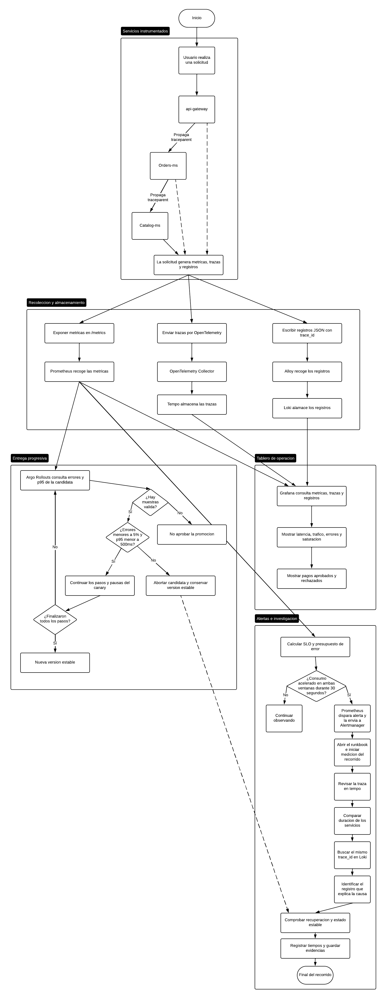

# Diagrama del flujo de telemetria

El diagrama muestra el recorrido de una solicitud por gateway, pedidos y
catalogo, y como se recogen sus metricas, trazas y registros. Esa informacion
se consulta en Grafana, permite evaluar el canary y ayuda a encontrar la causa
de una falla desde la alerta hasta el registro correspondiente.

## Como leer las lineas

- **Lineas continuas:** muestran el flujo principal, el movimiento de la
  informacion y las decisiones. Las salidas de los rombos indican que ocurre
  cuando la respuesta es Si o No. Una flecha no implica que todos los bloques
  se ejecuten uno despues de otro: la recoleccion ocurre en paralelo.
- **Lineas punteadas:** muestran relaciones de apoyo entre partes del flujo.
  Las que salen de gateway y pedidos indican que estos tambien generan
  telemetria, no solo catalogo. La que sale del aborto del canary relaciona esa
  recuperacion automatica con la comprobacion posterior del estado estable.

Las ramas de entrega progresiva y alertas funcionan de forma independiente:
Argo Rollouts puede abortar una candidata sin esperar a que una persona
investigue la alerta. El stack y sus reglas se despliegan mediante GitOps
con ArgoCD.

