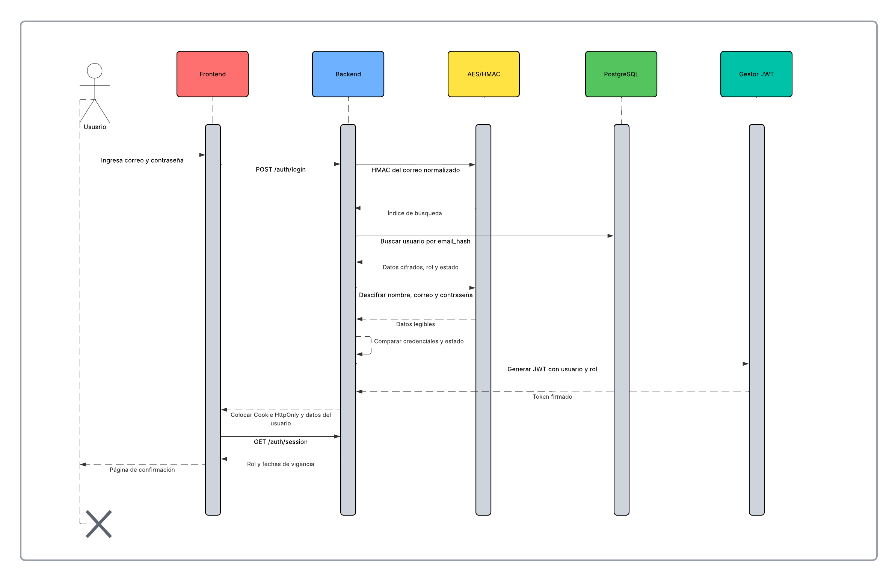
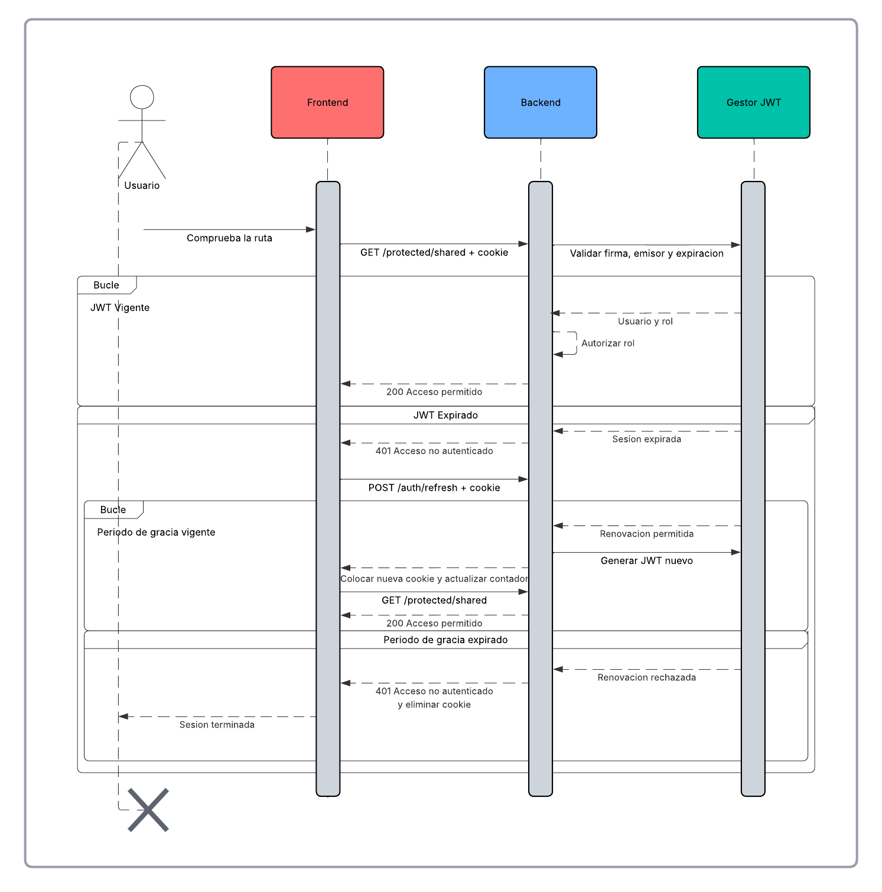

# UNIVERSIDAD DE SAN CARLOS DE GUATEMALA
## FACULTAD DE INGENIERÍA
### SOFTWARE AVANZADO

**CATEDRÁTICO:** Ing. Marco Tulio Aldana Prillwitz  
**TUTOR ACADÉMICO:** Kevin Pozuelos Estrada

---

**Jeremy Estuardo Orellana Aldana**  
**CARNÉ:** 202300644  
**SECCIÓN:** B

**Guatemala, 3 de agosto de 2026**

# Práctica 2 - Autenticación y autorización

## Índice

1. [Descripción](#descripción)
2. [Objetivos](#objetivos)
3. [Tecnologías utilizadas](#tecnologías-utilizadas)
4. [Ventajas y desventajas de las tecnologías](#ventajas-y-desventajas-de-las-tecnologías)
5. [Funcionalidades](#funcionalidades)
6. [Arquitectura y estructura](#arquitectura-y-estructura)
7. [Responsabilidad de las carpetas](#responsabilidad-de-las-carpetas)
8. [Base de datos y datos de prueba](#base-de-datos-y-datos-de-prueba)
9. [Configuración de variables de entorno](#configuración-de-variables-de-entorno)
10. [Ejecución con Docker Compose](#ejecución-con-docker-compose)
11. [Ejecución para desarrollo](#ejecución-para-desarrollo)
12. [Endpoints de la API](#endpoints-de-la-api)
13. [Formato de respuestas](#formato-de-respuestas)
14. [Autenticación con JWT](#autenticación-con-jwt)
15. [Cookies HTTP-only](#cookies-http-only)
16. [Renovación automática](#renovación-automática)
17. [Encriptación AES](#encriptación-aes)
18. [Autorización por roles](#autorización-por-roles)
19. [Principios SOLID](#principios-solid)
20. [Diagramas de secuencia](#diagramas-de-secuencia)
21. [Pruebas realizadas](#pruebas-realizadas)
22. [Verificación del proyecto](#verificación-del-proyecto)
23. [Uso de inteligencia artificial](#uso-de-inteligencia-artificial)

## Descripción

Aplicación full-stack para registrar usuarios, iniciar y cerrar sesión, renovar automáticamente una sesión y restringir rutas según los roles `ADMIN` y `CLIENTE`.

El frontend fue desarrollado con React y TypeScript. El backend utiliza Go y Fiber para exponer una API REST, mientras que PostgreSQL almacena los usuarios y roles. Los datos sensibles de los usuarios se guardan cifrados con AES-256-GCM y el JWT se transporta exclusivamente mediante una cookie HTTP-only.

La interfaz incluye una página de confirmación después del login, un temporizador que muestra la vigencia y el periodo de renovación, dos rutas protegidas y un módulo de administración de usuarios disponible únicamente para administradores.

## Objetivos

- Implementar registro y login mediante una API REST.
- Persistir los usuarios en una base de datos relacional.
- Proteger la autenticación mediante JWT almacenado en una cookie HTTP-only.
- Permitir que la vigencia y el periodo de gracia sean configurables.
- Renovar automáticamente el JWT cuando se encuentre dentro del tiempo permitido.
- Cifrar con AES la información sensible almacenada en PostgreSQL.
- Autorizar el acceso a rutas según los roles `ADMIN` y `CLIENTE`.
- Mantener el código separado por responsabilidades y aplicar principios SOLID.
- Ejecutar frontend, backend y base de datos mediante contenedores.

## Tecnologías utilizadas

| Tecnología | Uso en el proyecto |
|---|---|
| Go 1.23 | Lenguaje del backend |
| Fiber 2.52 | API REST, middleware y controladores HTTP |
| pgx 5 | Conexión y consultas a PostgreSQL |
| PostgreSQL | Base de datos relacional |
| AES-256-GCM | Cifrado autenticado de datos sensibles |
| HMAC-SHA256 | Índice determinista para buscar correos cifrados |
| JWT | Identificación y vigencia de la sesión |
| React 19 | Construcción de la interfaz |
| TypeScript 6 | Tipado del frontend |
| React Router | Navegación y protección de páginas |
| Vite 8 | Desarrollo y compilación del frontend |
| Nginx | Servidor del frontend compilado y proxy de la API |
| Docker Compose | Orquestación de los tres servicios |
| Go testing | Pruebas unitarias del backend |

## Ventajas y desventajas de las tecnologías

### Go y Fiber

**Ventajas**

- Go produce un ejecutable pequeño y fácil de desplegar.
- El tipado estático permite detectar errores antes de ejecutar el servidor.
- Fiber ofrece rutas y middleware sencillos para construir una API REST.
- Las interfaces de Go facilitan separar servicios, repositorios y componentes de seguridad.

**Desventajas**

- El manejo explícito de errores hace que algunas funciones sean más extensas.
- Fiber no utiliza directamente las interfaces estándar de `net/http`, por lo que algunas integraciones requieren adaptaciones.

### React, TypeScript y Vite

**Ventajas**

- React permite dividir la interfaz en componentes reutilizables.
- TypeScript detecta incompatibilidades en las respuestas y propiedades antes de compilar.
- Vite ofrece compilación rápida y una configuración pequeña.
- El contexto de React permite compartir el estado de sesión sin mostrar el JWT.

**Desventajas**

- El estado del frontend no reemplaza la autorización del backend.
- Una aplicación de una sola página necesita configuración adicional en Nginx para conservar las rutas al recargar.

### PostgreSQL y pgx

**Ventajas**

- PostgreSQL permite usar claves foráneas, restricciones, índices y transacciones.
- pgx proporciona un pool de conexiones y trabaja directamente con PostgreSQL.
- El volumen del contenedor conserva los datos después de reiniciar los servicios.

**Desventajas**

- Requiere administrar una instancia o contenedor adicional.
- Los datos cifrados no pueden buscarse directamente como texto; por eso se necesita un índice HMAC para el correo.

### JWT y cookies HTTP-only

**Ventajas**

- El backend puede verificar identidad, rol, emisor y expiración usando la firma.
- La cookie HTTP-only impide que JavaScript lea el token.
- El tiempo de vida y la gracia pueden ajustarse sin recompilar el proyecto.

**Desventajas**

- Un JWT emitido no se revoca individualmente sin agregar una lista de revocación.
- Las cookies necesitan configurar correctamente `Secure`, `SameSite`, CORS y HTTPS según el ambiente.

### Docker Compose

**Ventajas**

- Inicia frontend, backend y PostgreSQL con un solo comando.
- Mantiene versiones y dependencias iguales entre computadoras.
- Los health checks controlan el orden de inicio.

**Desventajas**

- La primera construcción descarga imágenes y dependencias.
- En Windows normalmente requiere Docker Desktop y WSL 2; también puede ejecutarse con Docker o Podman en Linux.

## Funcionalidades

- Registro de usuarios con rol inicial `CLIENTE`.
- Validación de nombre, correo y contraseña.
- Prevención de correos duplicados mediante HMAC-SHA256.
- Login de usuarios activos.
- Emisión de JWT firmado con HS256.
- Almacenamiento del JWT en cookie HTTP-only.
- Página visible de confirmación después del login.
- Consulta de la sesión actual sin exponer el token.
- Temporizador de token activo y periodo de renovación.
- Renovación automática desde el frontend.
- Aviso y redirección cuando la sesión deja de ser renovable.
- Cierre de sesión y eliminación de la cookie.
- Ruta exclusiva para `ADMIN`.
- Ruta compartida para `ADMIN` y `CLIENTE`.
- Listado, consulta, activación y desactivación de usuarios por un administrador.
- Protección para impedir que el administrador desactive su propia cuenta.
- Datos iniciales para realizar pruebas inmediatamente.

## Arquitectura y estructura

El backend utiliza una organización modular. La petición entra por `routes`, pasa por middleware, llega al `controller`, continúa al `service` y utiliza un `repository` cuando necesita PostgreSQL.


Estructura principal:

```text
P2/
├── backend/
│   ├── cmd/api/main.go
│   ├── database/
│   │   ├── Dockerfile
│   │   └── init.sql
│   ├── internal/
│   │   ├── config/
│   │   ├── infrastructure/database/
│   │   ├── modules/
│   │   │   ├── auth/
│   │   │   │   ├── controller/
│   │   │   │   ├── dto/
│   │   │   │   ├── middleware/
│   │   │   │   ├── routes/
│   │   │   │   └── service/
│   │   │   ├── protected/
│   │   │   └── users/
│   │   │       ├── controller/
│   │   │       ├── dto/
│   │   │       ├── model/
│   │   │       ├── repository/
│   │   │       ├── routes/
│   │   │       └── service/
│   │   └── shared/
│   │       ├── cookies/
│   │       ├── crypto/
│   │       ├── jwt/
│   │       ├── response/
│   │       └── validator/
│   └── Dockerfile
├── frontend/
│   ├── src/
│   │   ├── api/
│   │   ├── components/
│   │   ├── contexts/
│   │   ├── hooks/
│   │   ├── pages/
│   │   ├── router/
│   │   └── types/
│   ├── Dockerfile
│   └── nginx.conf
├── Documentacion/README.md
├── .env.example
└── docker-compose.yml
```

## Responsabilidad de las carpetas

- `cmd/api`: crea las dependencias e inicia el servidor.
- `config`: carga y valida variables de entorno.
- `infrastructure/database`: abre y comprueba el pool de PostgreSQL.
- `controller`: traduce peticiones y errores a respuestas HTTP.
- `dto`: define estructuras de entrada y salida.
- `middleware`: autentica el JWT y autoriza los roles.
- `model`: representa usuarios, roles y estados.
- `repository`: implementa las consultas de PostgreSQL.
- `service`: contiene reglas de registro, login y administración.
- `shared/cookies`: crea, lee y elimina la cookie de sesión.
- `shared/crypto`: cifra con AES y crea índices HMAC.
- `shared/jwt`: genera y valida tokens y su periodo de gracia.
- `shared/response`: mantiene un formato JSON uniforme.
- `shared/validator`: valida los datos del registro.
- `frontend/src/api`: centraliza las solicitudes HTTP y la renovación.
- `frontend/src/contexts`: conserva el estado visible de la sesión.
- `frontend/src/components`: contiene campos, layouts, temporizador y protección de páginas.
- `frontend/src/pages`: contiene login, registro, confirmación, rutas y usuarios.
- `frontend/src/router`: registra las páginas públicas y protegidas.

## Base de datos y datos de prueba

La base contiene las tablas `roles` y `users`. Los usuarios referencian un rol mediante una clave foránea y solo aceptan los estados `ACTIVE`, `INACTIVE` y `BLOCKED`.

Campos principales de `users`:

| Campo | Descripción |
|---|---|
| `id` | UUID del usuario |
| `name_encrypted` | Nombre cifrado con AES-256-GCM |
| `email_encrypted` | Correo cifrado con AES-256-GCM |
| `email_hash` | HMAC-SHA256 normalizado para búsqueda y unicidad |
| `password_encrypted` | Contraseña cifrada con AES-256-GCM |
| `role_id` | Relación con `roles` |
| `status` | Estado de la cuenta |
| `created_at` | Fecha de creación |
| `updated_at` | Fecha de actualización automática |

El script `backend/database/init.sql` crea tablas, restricciones, índices, trigger de actualización y usuarios de prueba.

### Credenciales de prueba

| Rol | Correo | Contraseña | Acceso esperado |
|---|---|---|---|
| ADMIN | `admin@practica.local` | `Admin123!` | Ambas rutas y administración de usuarios |
| CLIENTE | `cliente@practica.local` | `Cliente123!` | Solo ruta compartida |

Estas credenciales son exclusivamente para desarrollo y demostración.

## Configuración de variables de entorno

Crear el archivo `.env` en la raíz a partir del ejemplo:

**Git Bash o Linux:**

```bash
cp .env.example .env
```

**PowerShell:**

```powershell
Copy-Item .env.example .env
```

Variables principales:

| Variable | Descripción | Valor de desarrollo |
|---|---|---|
| `POSTGRES_DB` | Nombre de la base | `practica2` |
| `POSTGRES_USER` | Usuario PostgreSQL | `practica2_user` |
| `POSTGRES_PASSWORD` | Contraseña PostgreSQL | `practica2_password` |
| `POSTGRES_PORT` | Puerto local de PostgreSQL | `5432` |
| `AES_KEY` | Clave Base64 de 32 bytes para AES | Definida en Compose |
| `EMAIL_INDEX_KEY` | Clave Base64 para HMAC | Definida en Compose |
| `JWT_SECRET` | Secreto de firma, mínimo 32 caracteres | Definido en Compose |
| `JWT_EXPIRATION_MINUTES` | Vigencia del JWT | `1` |
| `JWT_RENEWAL_GRACE_MINUTES` | Gracia posterior al vencimiento | `1` |
| `JWT_ISSUER` | Emisor esperado | `practica2-api` |
| `COOKIE_SECURE` | Envío exclusivo mediante HTTPS | `false` en local |
| `COOKIE_SAME_SITE` | Política SameSite | `Lax` |

Las claves incluidas son únicamente de desarrollo porque coinciden con los datos cifrados del script inicial. En producción deben utilizarse secretos nuevos, HTTPS y `COOKIE_SECURE=true`.

## Ejecución con Docker Compose

Requisitos:

- Docker con Docker Compose, o Podman con proveedor de Compose.
- Puertos `5173` y `8080` disponibles.

Desde la carpeta `P2`:

```bash
docker compose up -d --build
```

Comprobar los servicios:

```bash
docker compose ps
```

Comprobar el backend:

```bash
curl http://localhost:8080/health
```

Abrir la aplicación:

```text
http://localhost:5173
```

Ver registros:

```bash
docker compose logs -f backend frontend database
```

Detener los contenedores sin borrar los datos:

```bash
docker compose down
```

El volumen `practica2-postgres-data` conserva PostgreSQL. Para reiniciar completamente los datos se puede eliminar el volumen de forma intencional:

```bash
docker compose down -v
```

## Ejecución para desarrollo

### Base de datos

Se puede iniciar únicamente PostgreSQL:

```bash
docker compose up -d database
```

### Backend

Crear `backend/.env` desde `backend/.env.example` y ajustar `DATABASE_URL` si es necesario.

```bash
cd backend
go mod download
go run ./cmd/api
```

El backend estará disponible en `http://localhost:8080`.

### Frontend

En otra terminal:

```bash
cd frontend
pnpm install
pnpm dev
```

El frontend estará disponible en `http://localhost:5173`.

## Endpoints de la API

Prefijo general: `/api/v1`

### Estado del servicio

| Método | Ruta | Acceso | Descripción |
|---|---|---|---|
| GET | `/health` | Público | Comprueba backend y PostgreSQL |

### Autenticación

| Método | Ruta | Acceso | Descripción |
|---|---|---|---|
| POST | `/api/v1/auth/register` | Público | Registra un usuario CLIENTE |
| POST | `/api/v1/auth/login` | Público | Valida credenciales y crea la cookie |
| POST | `/api/v1/auth/refresh` | Cookie vencida dentro de gracia | Renueva el JWT |
| POST | `/api/v1/auth/logout` | Público | Elimina la cookie |
| GET | `/api/v1/auth/session` | Autenticado | Devuelve rol y tiempos, nunca el token |

Ejemplo de registro:

```json
{
  "name": "Nuevo Usuario",
  "email": "usuario@example.com",
  "password": "Segura123!"
}
```

Ejemplo de login:

```json
{
  "email": "admin@practica.local",
  "password": "Admin123!"
}
```

### Rutas protegidas

| Método | Ruta | ADMIN | CLIENTE |
|---|---|---:|---:|
| GET | `/api/v1/protected/admin` | Permitido | Denegado con `403` |
| GET | `/api/v1/protected/shared` | Permitido | Permitido |

### Administración de usuarios

| Método | Ruta | Acceso | Descripción |
|---|---|---|---|
| GET | `/api/v1/users/` | ADMIN | Lista usuarios descifrados |
| GET | `/api/v1/users/:id` | ADMIN | Consulta un usuario |
| PATCH | `/api/v1/users/:id/status` | ADMIN | Activa o desactiva una cuenta |

Ejemplo de cambio de estado:

```json
{
  "status": "INACTIVE"
}
```

El administrador no puede cambiar el estado de su propia cuenta. Esta regla evita que la sesión administrativa utilizada para gestionar usuarios quede deshabilitada accidentalmente.

## Formato de respuestas

Respuesta exitosa:

```json
{
  "success": true,
  "message": "Sesión activa",
  "data": {
    "id": "00000000-0000-4000-8000-000000000001",
    "role": "ADMIN",
    "expiresAt": 1785809108,
    "renewableUntil": 1785809168
  }
}
```

El identificador puede utilizarse internamente, pero la interfaz no lo presenta al usuario. `expiresAt` y `renewableUntil` son marcas de tiempo, no contienen el JWT ni información secreta.

Respuesta de error:

```json
{
  "success": false,
  "message": "No tienes permiso para acceder",
  "error": {
    "code": "FORBIDDEN"
  }
}
```

Códigos utilizados:

| HTTP | Uso principal |
|---:|---|
| 200 | Login, consulta, renovación o actualización correcta |
| 201 | Usuario registrado |
| 400 | JSON, UUID o estado inválido |
| 401 | Sesión ausente, inválida o vencida |
| 403 | Rol sin permiso o usuario inactivo |
| 404 | Usuario no encontrado |
| 409 | Correo repetido o intento de desactivación propia |
| 422 | Datos de registro que no cumplen las reglas |
| 500 | Error interno controlado |

## Autenticación con JWT

Al iniciar sesión, el backend busca el correo mediante su índice HMAC, descifra los datos guardados y compara las credenciales. Si el usuario existe y está activo, genera un JWT con:

- `sub`: UUID del usuario.
- `role`: rol utilizado por la autorización.
- `iss`: emisor configurado.
- `iat`: fecha de emisión.
- `exp`: fecha de expiración.

La firma utiliza HS256 y `JWT_SECRET`. Antes de aceptar una ruta, el gestor valida el algoritmo, firma, emisor, expiración y datos obligatorios.

El JWT no forma parte del JSON de login y el frontend nunca lo guarda en `localStorage` ni `sessionStorage`.

## Cookies HTTP-only

La cookie se llama `auth_token` y utiliza:

- `HttpOnly`: impide que JavaScript acceda al valor.
- `Path=/`: permite enviarla a las rutas de la aplicación.
- `SameSite=Lax`: reduce solicitudes entre sitios en el ambiente local.
- `Secure`: configurable; debe estar activo cuando se utilice HTTPS.
- `MaxAge`: suma de la vigencia y el periodo de gracia.

El navegador incluye la cookie mediante `credentials: 'include'`. El frontend solo conserva datos no sensibles de sesión, como rol y fechas de vigencia.

## Renovación automática

Para la demostración se configuró:

```text
JWT activo:              60 segundos
Periodo de gracia:       60 segundos
Límite sin renovación:  120 segundos desde la emisión
```

Las solicitudes realizadas mientras el JWT sigue vigente se procesan normalmente. Cuando una solicitud recibe `401 SESSION_EXPIRED`, el cliente llama una vez a `/auth/refresh`.

Si el JWT venció hace menos de un minuto, el backend:

1. Lee el token vencido desde la cookie.
2. Verifica firma, emisor, usuario, rol y periodo de gracia.
3. Emite un JWT nuevo.
4. Reemplaza la cookie HTTP-only.
5. Devuelve únicamente las nuevas fechas.
6. El frontend repite la solicitud original una vez.

Si se supera el periodo de gracia, se elimina la sesión y la interfaz muestra un aviso antes de solicitar nuevamente las credenciales.

El temporizador del frontend distingue `Token activo` y `Renovación disponible`. Su función es demostrar el comportamiento; la decisión de seguridad siempre pertenece al backend.

## Encriptación AES

El proyecto utiliza AES-256-GCM. AES cifra la información y GCM también verifica su integridad. Cada cifrado genera un `nonce` aleatorio, por lo que el mismo texto produce valores diferentes.

Se cifran:

- Nombre.
- Correo.
- Contraseña, según lo solicitado por el enunciado.

Formato almacenado:

```text
Base64(nonce + texto cifrado + etiqueta de autenticación)
```

El correo cifrado no puede compararse directamente porque utiliza un nonce aleatorio. Para conservar unicidad y permitir el login se guarda adicionalmente:

```text
HMAC-SHA256(EMAIL_INDEX_KEY, correo normalizado)
```

Este índice no permite recuperar el correo original. El valor legible solo se obtiene descifrando `email_encrypted` con `AES_KEY`.

Las claves se cargan mediante variables de entorno y no se escriben dentro de las funciones de negocio.

## Autorización por roles

La autenticación comprueba quién realiza la solicitud. La autorización determina si su rol puede utilizar la ruta.

El middleware `Autenticar` valida la cookie y coloca el UUID, rol y fechas de sesión en el contexto de Fiber. Después, `Autorizar` compara el rol con los permitidos para la ruta.

| Rol | Ruta administrativa | Ruta compartida | Administración de usuarios |
|---|---:|---:|---:|
| ADMIN | Permitido | Permitido | Permitido |
| CLIENTE | Denegado | Permitido | Denegado |

El frontend oculta opciones que no corresponden al rol para mejorar la experiencia, pero esto no reemplaza el middleware. Una llamada manual realizada por un cliente a una ruta administrativa recibe `403 Forbidden`.

## Principios SOLID

**S - Principio de responsabilidad única**

Este principio lo apliqué separando las tareas del proyecto. Las rutas registran las direcciones, el controller recibe las peticiones, el service realiza las reglas del sistema y el repository se encarga de PostgreSQL. También separé el manejo de cookies, JWT y cifrado para que cada parte tenga una sola responsabilidad.

Ejemplo del servicio de login:

```go
type ServicioLogin struct {
    lector       repositorio.LectorUsuario
    descifrador  seguridad.Descifrador
    generador    token.Generador
    indice       seguridad.IndiceCorreo
}
```

**O - Principio abierto/cerrado**

Este principio lo apliqué porque puedo agregar otra forma de buscar usuarios, cifrar datos o generar tokens sin cambiar las reglas que ya existen en el servicio de login. Solamente tendría que crear otra implementación que cumpla las mismas interfaces.

Ejemplo:

```go
func NuevoServicioLogin(
    lector repositorio.LectorUsuario,
    descifrador seguridad.Descifrador,
    generador token.Generador,
    indice seguridad.IndiceCorreo,
) (*ServicioLogin, error)
```

**L - Principio de sustitución de Liskov**

Este principio lo apliqué porque el generador de JWT puede cambiarse por otra implementación que realice el mismo trabajo. Mientras la nueva implementación respete la interfaz y devuelva un token válido, el servicio podrá utilizarla sin cambiar su funcionamiento.

Ejemplo:

```go
type Generador interface {
    Generar(id string, rol string) (string, error)
}
```

**I - Principio de segregación de interfaces**

Este principio lo apliqué creando interfaces pequeñas para cada tarea del JWT. Una interfaz genera tokens, otra los valida y otra revisa si pueden renovarse. De esta forma cada componente recibe únicamente las funciones que necesita y no depende de métodos que nunca utiliza.

Ejemplo:

```go
type Generador interface {
    Generar(id string, rol string) (string, error)
}

type Validador interface {
    Validar(valor string) (*Datos, error)
}

type ValidadorRenovacion interface {
    ValidarRenovacion(valor string) (*Datos, error)
}
```

**D - Principio de inversión de dependencias**

Este principio lo apliqué porque los servicios no trabajan directamente con PostgreSQL, AES o la librería JWT. Los servicios trabajan con interfaces y en `main.go` se decide cuáles implementaciones reales se utilizarán. Esto ayuda a que las reglas del sistema no estén unidas a una sola tecnología y también facilita las pruebas.

Ejemplo de la conexión de dependencias en `main.go`:

```go
repoUsuarios, _ := repositorio.NuevoRepositorioPostgres(pool)
registro, _ := servicio.NuevoServicioRegistro(
    repoUsuarios,
    repoUsuarios,
    cifrador,
    generadorCorreo,
)
```

## Diagramas de secuencia

### Inicio de sesión



### Ruta protegida y renovación automática



## Pruebas realizadas

### Pruebas unitarias

El backend contiene pruebas de:

- Generación, validación, expiración y gracia del JWT.
- Middleware de autenticación y autorización.
- Cifrado y descifrado AES-256-GCM.
- Generación determinista del índice HMAC.
- Validaciones del registro.
- Registro y login.
- Consultas y cambios de estado de usuarios.
- Repositorio PostgreSQL.

Ejecución:

```bash
cd backend
go test ./...
```

### Pruebas del frontend

```bash
cd frontend
pnpm run build
pnpm run lint
```

### Pruebas funcionales finales

| Prueba | Resultado esperado | Resultado obtenido |
|---|---|---|
| Estado del servicio | Backend y PostgreSQL conectados | Correcto |
| Registro | Usuario CLIENTE persistido | Correcto |
| Login ADMIN | Cookie creada sin exponer JWT | Correcto |
| Login CLIENTE | Cookie creada sin exponer JWT | Correcto |
| ADMIN en ruta exclusiva | 200 | Correcto |
| ADMIN en ruta compartida | 200 | Correcto |
| CLIENTE en ruta exclusiva | 403 | Correcto |
| CLIENTE en ruta compartida | 200 | Correcto |
| CLIENTE en usuarios | 403 | Correcto |
| Desactivar cuenta | Estado actualizado | Correcto |
| Login de cuenta inactiva | 403 | Correcto |
| Cambio del estado propio | 409 | Correcto |
| Renovación después de 62 segundos | JWT nuevo y solicitud repetida | Correcto |
| 122 segundos sin solicitudes | Sesión no renovable | Correcto |
| Logout | Cookie eliminada | Correcto |
| Consola del navegador | Sin errores | Correcto |

## Verificación del proyecto

Lista rápida para la demostración:

1. Ejecutar `docker compose up -d --build`.
2. Confirmar tres servicios activos con `docker compose ps`.
3. Abrir `http://localhost:5173`.
4. Iniciar sesión como `ADMIN`.
5. Verificar la página de confirmación.
6. Observar el temporizador de 60 segundos.
7. Probar las dos rutas y confirmar acceso permitido.
8. Entrar en `Usuarios` y comprobar la administración.
9. Cerrar sesión e ingresar como `CLIENTE`.
10. Confirmar acceso compartido y denegación administrativa.
11. Esperar el vencimiento y realizar una solicitud durante la gracia para observar la renovación.
12. Dejar otra sesión sin actividad por 120 segundos para comprobar el aviso de cierre.

Comandos finales:

```bash
docker compose ps
curl http://localhost:8080/health
cd backend && go test ./...
cd ../frontend && pnpm run build && pnpm run lint
```
