# UNIVERSIDAD DE SAN CARLOS DE GUATEMALA

## FACULTAD DE INGENIERIA

### SOFTWARE AVANZADO

**Nombre:** Jeremy Estuardo Orellana Aldana  
**Carne:** 202300644  
**Seccion:** B

# Practica 5 - Orquestacion de microservicios con Kubernetes y Helm

## Indice

1. Alcance de esta documentacion
2. Cambios realizados respecto de la Practica 4
3. Arquitectura de despliegue en Kubernetes
4. Estructura del chart de Helm
5. Instalacion reproducible
6. Configuracion y secretos
7. Persistencia
8. Comunicacion asincrona
9. Exposicion local y NetworkPolicies
10. Salud, escalado y resiliencia
11. Seguridad
12. CronJobs encadenados
13. Pruebas de carga
14. Ciclo de vida con Helm
15. Evidencias
16. Preguntas teoricas

# 1. Alcance de esta documentacion

Esta documentacion contiene solamente los elementos nuevos incorporados en la Practica 5. La descripcion funcional de la tienda, los cuatro microservicios, contratos REST y GraphQL, modelos de datos, diagramas ER, principios SOLID y ejecucion original con Docker Compose ya se encuentran en `P4/README` y no se duplican aqui.

# 2. Cambios realizados respecto de la Practica 4

- La plataforma se empaqueta en un chart padre de Helm con subcharts.
- Kubernetes reemplaza a Docker Compose como orquestador.
- RabbitMQ incorpora el procesamiento asincrono de pagos.
- PostgreSQL y RabbitMQ utilizan almacenamiento persistente.
- ConfigMaps y Secrets externalizan la configuracion.
- NetworkPolicies limitan la comunicacion entre componentes.
- Probes, HPA, PDB, ResourceQuota y LimitRange agregan resiliencia.
- Se incorporan dos CronJobs encadenados.

# 3. Arquitectura de despliegue en Kubernetes

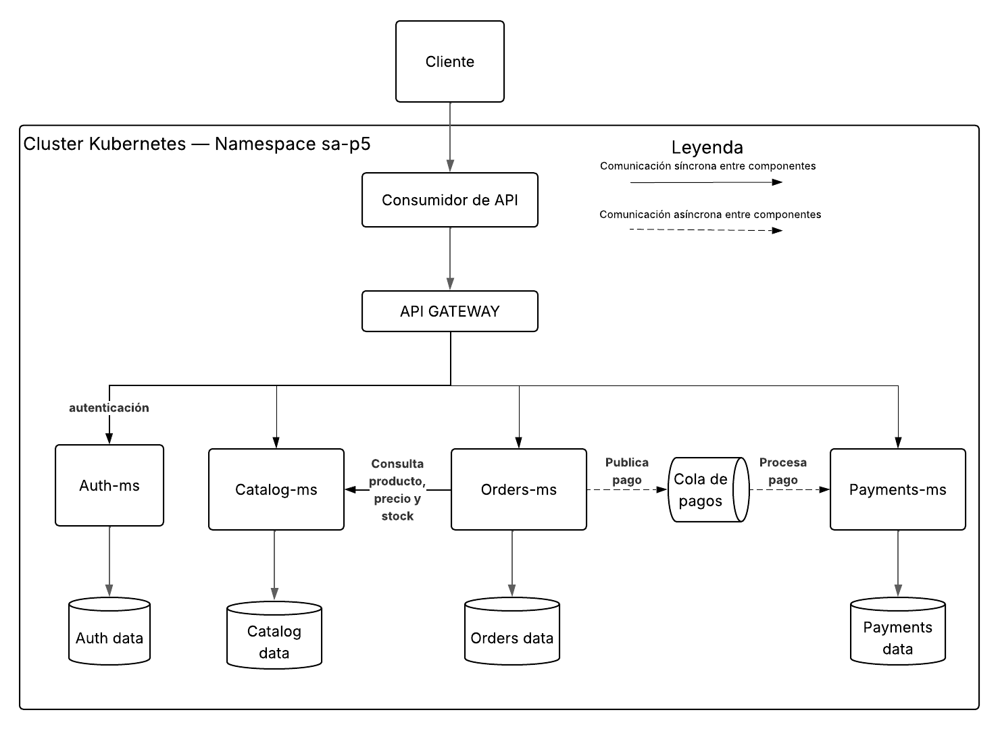

El API Gateway es el punto de entrada. El acceso de demostracion se realiza mediante `kubectl port-forward`; todos los Services permanecen como ClusterIP.

El flujo de pago es asincrono: Orders-ms publica en la cola durable `payment.requests`, Payments-ms consume y procesa, y finalmente notifica el resultado a Orders-ms para actualizar el estado de la orden.

# 4. Estructura del chart de Helm

`sa-platform` es el chart padre. Los componentes `api-gateway`, `auth-ms`, `catalog-ms`, `orders-ms` y `payments-ms` son subcharts. RabbitMQ y las cuatro instancias PostgreSQL se declaran como dependencias en `Chart.yaml`.

Los archivos principales son:

```text
P5/charts/sa-platform/
|-- Chart.yaml
|-- Chart.lock
|-- values.yaml
|-- values-dev.yaml
|-- values-prod.yaml
|-- values.example.yaml
|-- values-version-1.yaml
|-- values-version-2.yaml
|-- charts/
|   |-- api-gateway/
|   |-- auth-ms/
|   |-- catalog-ms/
|   |-- orders-ms/
|   `-- payments-ms/
`-- templates/
    |-- _helpers.tpl
    |-- configmaps.yaml
    |-- secrets.yaml
    |-- networkpolicies.yaml
    |-- resourcequota.yaml
    |-- limitrange.yaml
    |-- cronjobs.yaml
    `-- summary-consumer.yaml
```

`_helpers.tpl` define nombres y etiquetas reutilizables. Las plantillas utilizan `range` para generar recursos repetidos, `if` para valores opcionales, `required` para impedir secretos vacios, `default` para valores predeterminados y `quote` para cadenas YAML.

# 5. Instalacion reproducible

Los siguientes comandos parten de Minikube detenido. Las credenciales se guardan fuera del repositorio.

```bash
minikube start --driver=podman --container-runtime=containerd \
  --cpus=4 --memory=8192
minikube addons enable metrics-server

cd Practicas-SA-B-202300644
helm dependency update P5/charts/sa-platform
cp P5/charts/sa-platform/values.example.yaml /tmp/sa-p5-secrets.yaml
```

Antes de instalar se reemplazan los valores ficticios del archivo `/tmp/sa-p5-secrets.yaml`. Este archivo no debe copiarse ni confirmarse en Git.

```bash
helm lint P5/charts/sa-platform \
  -f P5/charts/sa-platform/values-dev.yaml \
  -f /tmp/sa-p5-secrets.yaml

helm install sa-platform P5/charts/sa-platform \
  -n default \
  -f P5/charts/sa-platform/values-dev.yaml \
  -f /tmp/sa-p5-secrets.yaml \
  --set-file 'auth-database.primary.initdb.scripts.init\.sql'=P4/auth-ms/database/init.sql \
  --set-file 'catalog-database.primary.initdb.scripts.init\.sql'=P4/catalog-ms/database/init.sql \
  --set-file 'orders-database.primary.initdb.scripts.init\.sql'=P4/orders-ms/database/init.sql \
  --set-file 'payments-database.primary.initdb.scripts.init\.sql'=P4/payments-ms/database/init.sql \
  --wait --timeout 10m
```

El release se almacena en `default`, pero el chart crea y administra el namespace `sa-p5`. Para acceder localmente al unico punto de entrada:

```bash
kubectl -n sa-p5 port-forward service/api-gateway 4000:4000
```

Comandos de verificacion:

```bash
helm list -A
kubectl -n sa-p5 get pods
kubectl -n sa-p5 get svc
kubectl -n sa-p5 get hpa,pdb,resourcequota,limitrange
kubectl -n sa-p5 get networkpolicy
```

La secuencia fue comprobada en un segundo perfil vacio de Minikube. `helm install` completo el despliegue en 1 minuto 44 segundos: todos los Deployments y StatefulSets quedaron disponibles, los cinco PVC quedaron `Bound` y se crearon 2 tablas de Auth, 4 de Catalog, 6 de Orders y 3 de Payments.

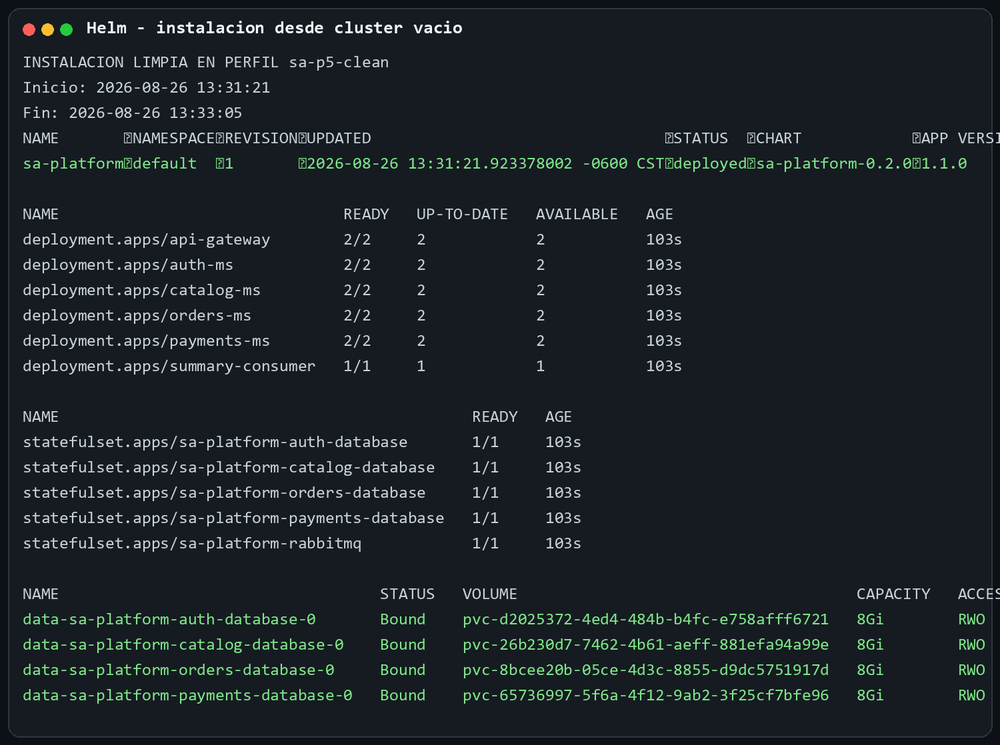

# 6. Configuracion y secretos

Las variables no sensibles se generan en ConfigMaps. Las contrasenas de PostgreSQL, credenciales de RabbitMQ, JWT y clave de cifrado se generan como Secrets y se inyectan con `envFrom`. El repositorio solo contiene `values.example.yaml` con datos ficticios.

`values-dev.yaml` y `values-prod.yaml` cambian replicas, recursos, tag de imagen y nivel de log. Cada Deployment incluye `checksum/config`; cuando Helm cambia el ConfigMap, cambia la plantilla del Pod y Kubernetes realiza un RollingUpdate automatico.

La prueba cambio `LOG_LEVEL` de `debug` a `checksum-proof`. El checksum paso de `7db4db...` a `81e24a...` y se crearon Pods con UID nuevos. Luego el valor se restauro a `debug` mediante otro `helm upgrade`.

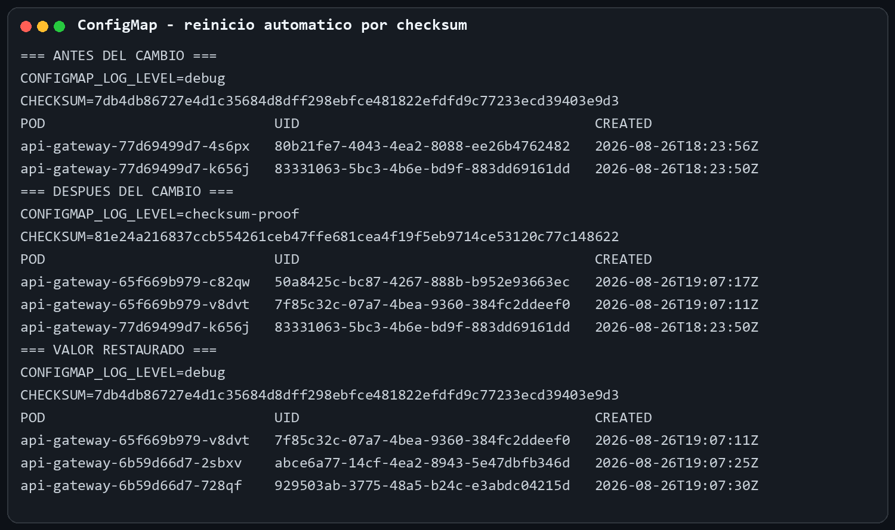

# 7. Persistencia

PostgreSQL y RabbitMQ se despliegan como StatefulSets con PVC de 8 GiB. Se elimino el Pod de la base de datos de Orders y Kubernetes lo recreo con otro UID, utilizando el mismo volumen.

Antes y despues existian 36 ejecuciones y 15 resumenes. El registro testigo continuo presente y el PVC `data-sa-platform-orders-database-0` permanecio `Bound` al mismo volumen.

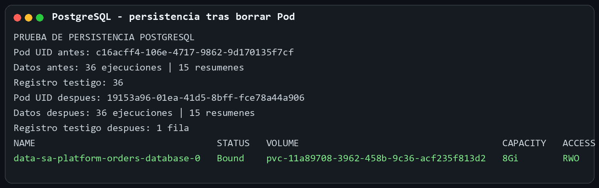

# 8. Comunicacion asincrona

Al solicitar el pago de una orden, Orders-ms publica un mensaje persistente en `payment.requests` y responde con el estado `PAGO_EN_PROCESO`. Payments-ms consume el mensaje, registra el pago de manera idempotente y confirma el mensaje solamente despues de guardar el resultado y notificar a Orders-ms. La orden termina en estado `PAGADA` o `PAGO_RECHAZADO`.

La cola se declaro durable. En la prueba con Payments-ms detenido se observo un mensaje listo, cero consumidores y la orden en proceso. Al restaurar el consumidor, el mensaje bajo a cero, aparecieron dos consumidores y la orden cambio a `PAGADA`, sin republicar la solicitud.

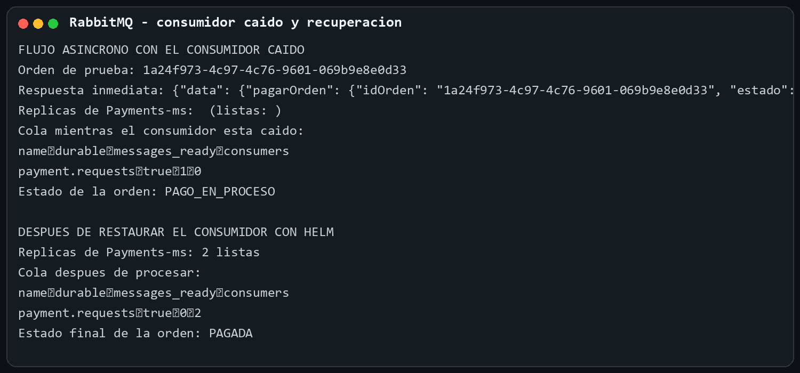

# 9. Exposicion local y NetworkPolicies

Todos los Services son ClusterIP. El acceso externo de demostracion se limita al API Gateway mediante `kubectl port-forward`, de acuerdo con la indicacion del auxiliar para este entorno privado local.

La politica predeterminada niega ingreso y salida. Se habilitan solamente DNS y los flujos del diagrama: gateway a microservicios, cada microservicio a su base autorizada, Orders y Payments a RabbitMQ, Payments a Orders para el callback, y los trabajos programados a Orders/RabbitMQ.

Un Pod sin la etiqueta autorizada obtuvo timeout al intentar llegar al API Gateway; un Pod con `access=api-gateway-client` recibio HTTP 200.

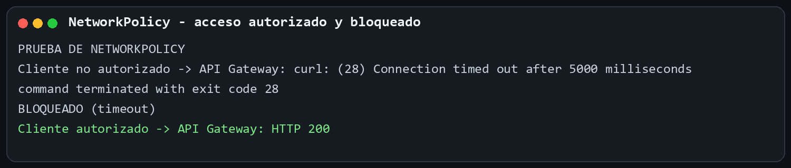

# 10. Salud, escalado y resiliencia

| Control | Funcion y justificacion |
| --- | --- |
| Startup probe | Da hasta 150 segundos para iniciar antes de aplicar liveness; evita reinicios prematuros mientras conecta dependencias. |
| Readiness probe | Retira del Service cualquier Pod que no pueda responder `/health`; se evalua cada 10 segundos. |
| Liveness probe | Reinicia procesos bloqueados despues del arranque; se evalua cada 20 segundos. |
| HPA | Minimo 2, maximo 5, objetivo 70 % de CPU para cada microservicio. |
| PDB | Mantiene al menos una replica disponible durante interrupciones voluntarias. |
| RollingUpdate | `maxUnavailable: 0` y `maxSurge: 1`; no elimina una replica util antes de preparar su reemplazo. |
| ResourceQuota | Limita Pods, CPU, memoria, almacenamiento y PVC totales del namespace. |
| LimitRange | Define solicitudes y limites predeterminados y evita contenedores sin cotas. |

Durante la prueba de carga Catalog-ms escalo de 2 a 5 replicas. Al terminar y cumplirse la ventana de estabilizacion, regreso automaticamente de 5 a 2.

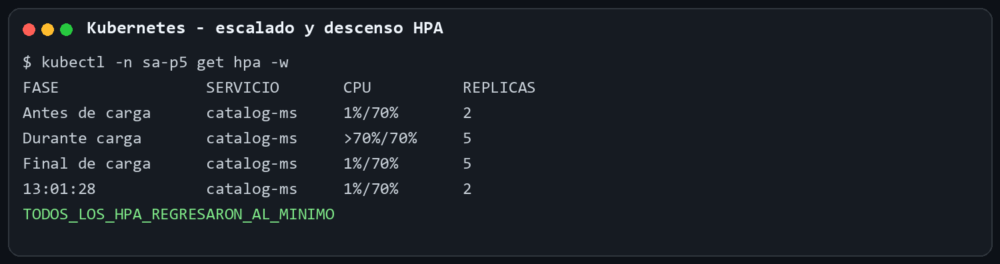

Para comprobar una actualizacion sin caida se enviaron 800 solicitudes continuas desde dentro del cluster durante el upgrade: las 800 respondieron HTTP 200, no hubo errores y siempre permanecieron al menos dos replicas listas. El API Gateway agrega `preStop` de 5 segundos para retirarse de los endpoints antes de finalizar.

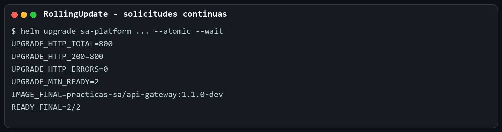

# 11. Seguridad

Cada microservicio, CronJob y consumidor programado usa un ServiceAccount dedicado junto con Role y RoleBinding. Ninguno utiliza el ServiceAccount `default`.

Los contenedores se ejecutan como usuario no root y configuran `readOnlyRootFilesystem: true`, `allowPrivilegeEscalation: false`, eliminacion de capabilities y perfil seccomp `RuntimeDefault`. Los Dockerfile usan multi-stage build y una imagen final minima.

| Imagen | Antes | Despues | Diferencia |
| --- | ---: | ---: | ---: |
| API Gateway | 17.61 MiB | 17.50 MiB | -0.11 MiB |
| Auth-ms | 23.64 MiB | 23.53 MiB | -0.11 MiB |
| Catalog-ms | 24.41 MiB | 24.31 MiB | -0.10 MiB |
| Orders-ms | 187.06 MiB | 178.75 MiB | -8.31 MiB |
| Payments-ms | 180.22 MiB | 171.91 MiB | -8.31 MiB |

En Python se eliminaron `pip` y `setuptools` del entorno final porque solo son necesarios durante la construccion.

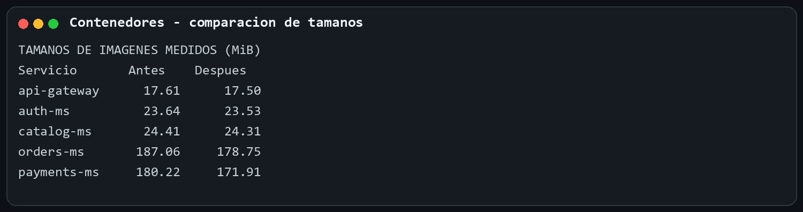

# 12. CronJobs encadenados

`execution-recorder` se ejecuta cada 2 minutos en `America/Guatemala` y almacena fecha, zona `GMT-6` y carne `202300644`. `summary-publisher` se ejecuta cada 10 minutos, agrupa ejecuciones por hora y publica el resultado en `scheduled.summary`. Un consumidor persistente almacena el resumen y confirma el mensaje despues de insertarlo.

Ambos CronJobs utilizan `concurrencyPolicy: Forbid`, `backoffLimit: 3`, historial de 3 Jobs exitosos y 3 fallidos. Las colas `payment.requests` y `scheduled.summary` aparecen como durables.

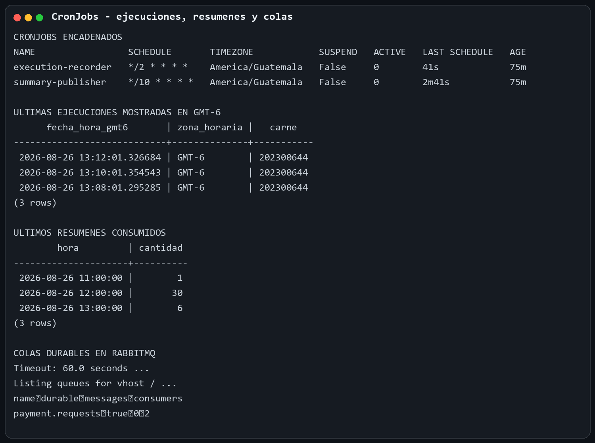

# 13. Pruebas de carga

El script reproducible se encuentra en `P5/load-tests/load.js`. La carga aumenta progresivamente de 50 a 200 usuarios virtuales y consume `POST /catalog/graphql` a traves del API Gateway.

Ejecucion mediante el API Gateway local:

```bash
kubectl -n sa-p5 port-forward service/api-gateway 4000:4000
docker run --rm --network host \
  -v "$PWD/P5/load-tests:/scripts:ro" \
  grafana/k6:0.57.0 run \
  -e BASE_URL=http://127.0.0.1:4000 /scripts/load.js
```

| Metrica | Resultado |
| --- | ---: |
| Solicitudes | 542,260 |
| Peticiones por segundo | 3,873.27 RPS |
| Latencia p95 | 102.71 ms |
| Tasa de error | 0.00 % |
| Usuarios virtuales maximos | 200 |

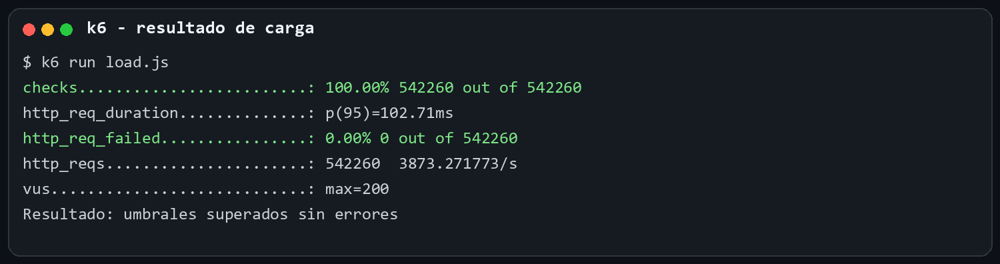

# 14. Ciclo de vida con Helm

La version inicial fue `sa-platform-0.1.0`, aplicacion 1.0.0. La version nueva es `sa-platform-0.2.0`, aplicacion 1.1.0.

```bash
helm upgrade sa-platform P5/charts/sa-platform \
  -n default --reuse-values \
  -f P5/charts/sa-platform/values-version-2.yaml \
  --atomic --wait --timeout 5m

helm rollback sa-platform 8 -n default --wait --timeout 5m
helm history sa-platform -n default
```

La revision 9 actualizo a 0.2.0. La revision 10 fue el rollback verificado a 0.1.0 y recupero la imagen 1.0.0. Las revisiones posteriores volvieron a desplegar 0.2.0; la evidencia conserva el historial completo.

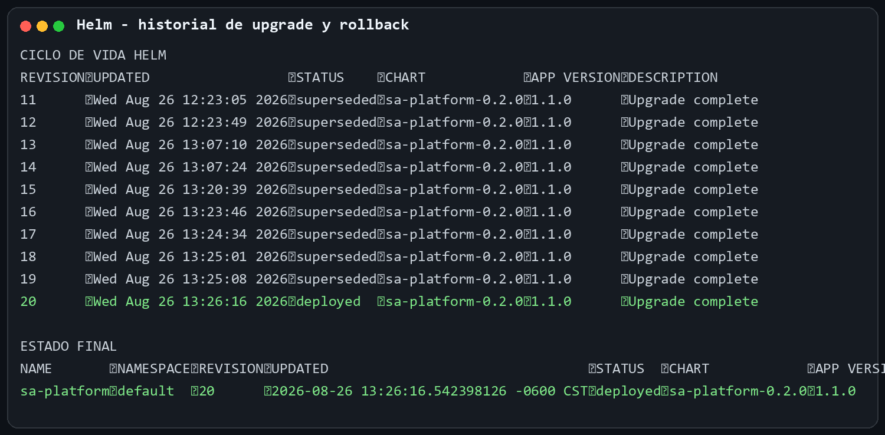

# 15. Evidencias

Las evidencias se almacenan en `P5/Documentacion/Imagenes/Evidencias` y se relacionan con cada prueba para evitar capturas sin contexto.

| Evidencia | Resultado demostrado |
| --- | --- |
| Prueba k6 | RPS, p95, error y 200 usuarios. |
| HPA | Catalog-ms escala a 5 y desciende a 2. |
| Persistencia | Pod nuevo conserva registros en el mismo PVC. |
| NetworkPolicy | Cliente no autorizado bloqueado y autorizado con HTTP 200. |
| Helm | Upgrade, rollback e historial de versiones. |
| ConfigMap | Cambio de checksum crea Pods nuevos. |
| Imagenes | Comparacion medida antes/despues. |
| RollingUpdate | 800 de 800 respuestas correctas durante el upgrade. |
| CronJobs | Horarios, registros, resumenes y colas durables. |
| Instalacion limpia | Release completo y tablas creadas desde un cluster vacio. |

# 16. Preguntas teoricas

Los siguientes puntos son un resumen para responder oralmente o redactar con palabras propias.

## 16.1 Que es Helm y que problema resuelve frente a manifiestos sueltos

Helm es un gestor de paquetes para Kubernetes. Agrupa recursos relacionados en un chart, permite parametrizarlos y registra cada instalacion como una revision. Evita mantener muchos YAML repetidos por ambiente y permite instalar, actualizar o revertir la plataforma como una sola unidad.

## 16.2 Diferencia entre chart, release y repository

- Chart: paquete y plantillas que describen la aplicacion.
- Release: instancia instalada de un chart con valores concretos y un historial de revisiones.
- Repository: lugar donde se publican y descargan charts versionados.

Una analogia breve: el chart es la receta, el release es el plato preparado y el repository es el catalogo de recetas.

## 16.3 Que es un StatefulSet y cuando no usarlo

StatefulSet administra Pods con identidad, nombre, orden y almacenamiento persistente estables. Es apropiado para bases de datos o brokers que necesitan conservar identidad y volumen. No debe usarse para APIs sin estado: para ellas un Deployment es mas simple, permite reemplazos intercambiables y escala con mayor libertad.

## 16.4 Diferencia entre liveness, readiness y startup probe

- Startup: determina si la aplicacion termino de iniciar; mientras falla, protege al contenedor de liveness.
- Readiness: determina si el Pod puede recibir trafico; si falla, se retira de los endpoints sin reiniciarlo.
- Liveness: determina si el proceso sigue sano; si falla repetidamente, Kubernetes reinicia el contenedor.

## 16.5 Que es una NetworkPolicy y por que el trafico se permite por defecto

NetworkPolicy expresa que trafico de ingreso o salida puede usar un grupo de Pods. Kubernetes inicia con comunicacion abierta para mantener compatibilidad y facilidad de uso. Un Pod queda aislado solamente cuando una politica lo selecciona para ingress o egress; por eso se aplica primero una politica default-deny y luego permisos explicitos.

## 16.6 Que es un PodDisruptionBudget

Es una regla de disponibilidad durante interrupciones voluntarias como drenado de nodos o mantenimiento. Define cuantos Pods deben permanecer disponibles o cuantos pueden interrumpirse. No evita fallos inesperados ni reemplaza replicas, probes o una buena estrategia de despliegue.

## 16.7 Ventajas y problemas nuevos de la comunicacion asincrona

Ventajas: desacopla productor y consumidor, absorbe picos, permite reintentos y mantiene solicitudes cuando el consumidor esta temporalmente caido. Problemas nuevos: mensajes duplicados, orden no garantizado, consistencia eventual, colas acumuladas, necesidad de idempotencia, confirmaciones, monitoreo y manejo de mensajes que fallan repetidamente.

## 16.8 Que hace helm rollback internamente

Helm busca la configuracion y los manifiestos guardados para una revision anterior, calcula los cambios contra el estado actual y los vuelve a aplicar mediante la API de Kubernetes. El rollback no borra el historial: crea una revision nueva cuyo contenido corresponde a la version elegida, por lo que tambien queda auditable y puede revertirse nuevamente.
