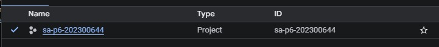
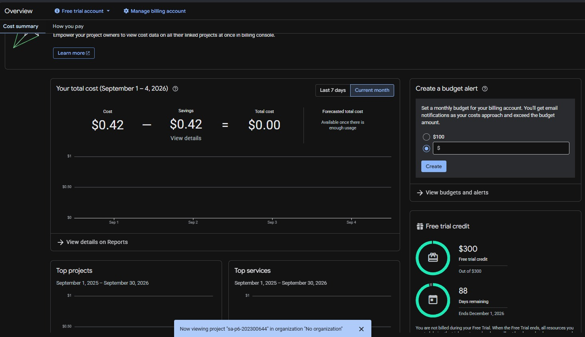
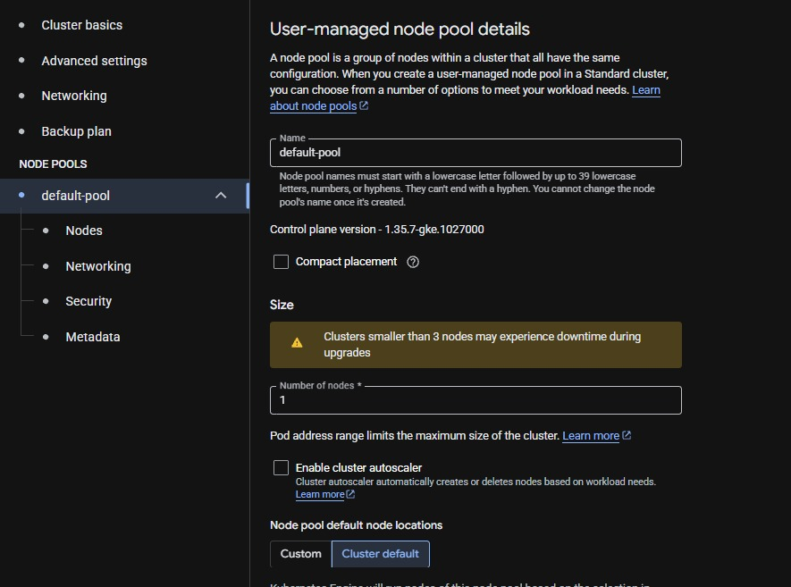
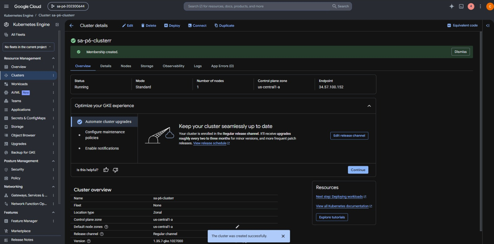
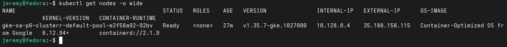
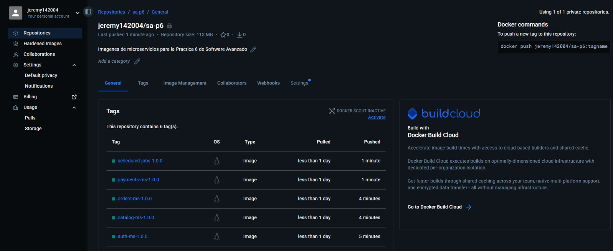
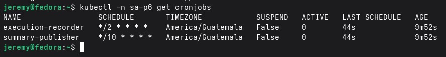
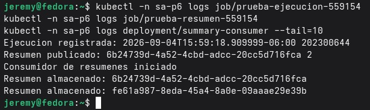

# Práctica 6 - Despliegue de CronJobs en Google Kubernetes Engine

## Datos generales

- **Curso:** Software Avanzado
- **Carné:** 202300644
- **Proveedor de nube:** Google Cloud Platform (GCP)
- **Servicio administrado:** Google Kubernetes Engine (GKE)
- **Registro de imágenes:** Docker Hub privado
- **Base de datos:** PostgreSQL 18 en NeonDB
- **Mensajería:** RabbitMQ

## 1. Descripción

En esta práctica se trasladaron a la nube los dos CronJobs desarrollados previamente. La solución se ejecuta en un clúster zonal de GKE y utiliza RabbitMQ para la comunicación asíncrona y NeonDB para almacenar las ejecuciones y los resúmenes generados.

Por indicación del auxiliar se utilizó un solo nodo para reducir el consumo de créditos. El despliegue evaluado está compuesto por:

- `execution-recorder`: registra la fecha, hora, zona horaria y carné en NeonDB.
- `summary-publisher`: consulta las ejecuciones y publica un resumen en RabbitMQ.
- `summary-consumer`: recibe el mensaje y almacena el resumen en NeonDB.
- RabbitMQ con almacenamiento persistente de GCP.

Aunque durante la preparación también se publicaron las imágenes de los microservicios de las prácticas anteriores, el despliegue activo se ajustó a los dos CronJobs que serán demostrados durante la calificación.

## 2. Recursos utilizados

| Recurso | Configuración |
|---|---|
| Proyecto de GCP | `sa-p6-202300644` |
| Clúster | `sa-p6-clusterr` |
| Modalidad | GKE Standard |
| Ubicación | Zonal, `us-central1-a` |
| Nodos | 1 |
| Máquina | `e2-medium`, 2 vCPU compartidos y 4 GB de memoria |
| Sistema del nodo | Container-Optimized OS con containerd |
| Repositorio | `jeremy142004/sa-p6`, privado |
| Namespace | `sa-p6` |
| StorageClass | `sa-p6-balanced`, respaldada por Persistent Disk de GCP |
| Volumen de RabbitMQ | 8 GiB |
| Base de CronJobs | `scheduled_jobs_db` en el proyecto Neon `sa-p6-cronjobs` |

## 3. Creación del proyecto y control de costos

Se creó el proyecto `sa-p6-202300644` y se vinculó con una cuenta de prueba gratuita. La cuenta contaba con USD 300 en créditos. Antes de crear recursos se revisó el panel de facturación para conocer el saldo y vigilar el gasto.





## 4. Creación del clúster

Se habilitó Kubernetes Engine API y se creó un clúster **Standard** y **zonal**. El grupo `default-pool` se configuró con un nodo y sin autoescalado, de acuerdo con la autorización del auxiliar para reducir costos.



El clúster quedó en estado `Running`, con un nodo y el plano de control en `us-central1-a`.



La laptop Fedora se utilizó únicamente como estación de administración. No aloja la solución: `gcloud`, `kubectl` y Helm se comunican por internet con el clúster real de GCP.

```bash
gcloud auth login
gcloud config set project sa-p6-202300644
gcloud container clusters get-credentials sa-p6-clusterr \
  --zone us-central1-a \
  --project sa-p6-202300644
kubectl get nodes -o wide
```



## 5. Publicación de imágenes

Se creó el repositorio privado `jeremy142004/sa-p6` en Docker Hub. Las imágenes se construyeron con los archivos `Dockerfile.prod` de múltiples etapas y se publicaron con las siguientes etiquetas:

```text
api-gateway-1.0.0
auth-ms-1.0.0
catalog-ms-1.0.0
orders-ms-1.0.0
payments-ms-1.0.0
scheduled-jobs-1.0.0
```



Como el repositorio es privado, GKE utiliza el Secret `dockerhub-cred`. El token se proporciona desde la terminal y no se almacena en Git.

```bash
kubectl -n sa-p6 create secret docker-registry dockerhub-cred \
  --docker-server=https://index.docker.io/v1/ \
  --docker-username=jeremy142004 \
  --docker-password='TOKEN_DOCKERHUB'
```

## 6. Bases de datos y Secrets

Se utilizaron tres proyectos de NeonDB para separar las cinco bases de datos de la plataforma:

1. `sa-p6-auth-catalog`: `auth_db` y `catalog_db`.
2. `sa-p6-orders-payments`: `orders_db` y `payments_db`.
3. `sa-p6-cronjobs`: `scheduled_jobs_db`.

Los CronJobs utilizan exclusivamente `scheduled_jobs_db`. La cadena de conexión se guarda en el Secret `scheduled-jobs-secret`. Los archivos `.env` y `P6/valores-secretos.yaml` están excluidos mediante `.gitignore`.

```bash
git check-ignore \
  ../P4/auth-ms/.env \
  ../P4/catalog-ms/.env \
  ../P4/orders-ms/.env \
  ../P4/payments-ms/.env \
  ../P5/cronjobs/.env \
  valores-secretos.yaml
```

Las tablas utilizadas son:

- `scheduled_jobs.ejecuciones`
- `scheduled_jobs.resumenes_hora`

## 7. Despliegue con Helm

El Chart se encuentra en `P6/charts/sa-platform`. Para el nodo `e2-medium` se redujeron únicamente las solicitudes de CPU de RabbitMQ y de los trabajos; los límites de memoria y CPU permanecen definidos.

```bash
cd P6/charts/sa-platform
helm dependency build
helm upgrade --install sa-platform . \
  --namespace sa-p6 \
  --values ../../valores-secretos.yaml \
  --wait \
  --timeout 12m
```

El despliegue crea los siguientes recursos principales:

- Dos objetos `CronJob`.
- Un `Deployment` para `summary-consumer`.
- Un `StatefulSet` de RabbitMQ.
- Un PVC de 8 GiB.
- ConfigMaps, Secrets, ServiceAccounts, RBAC y NetworkPolicies.

## 8. Funcionamiento de los CronJobs

Los horarios configurados son:

| CronJob | Programación | Zona horaria |
|---|---|---|
| `execution-recorder` | Cada 2 minutos | `America/Guatemala` |
| `summary-publisher` | Cada 10 minutos | `America/Guatemala` |



Para ejecutar ambos durante la calificación:

```bash
NOMBRE_EJECUCION="prueba-ejecucion-$(date +%s)"
kubectl -n sa-p6 create job \
  --from=cronjob/execution-recorder "$NOMBRE_EJECUCION"
kubectl -n sa-p6 wait \
  --for=condition=complete "job/$NOMBRE_EJECUCION" \
  --timeout=5m
kubectl -n sa-p6 logs "job/$NOMBRE_EJECUCION"

NOMBRE_RESUMEN="prueba-resumen-$(date +%s)"
kubectl -n sa-p6 create job \
  --from=cronjob/summary-publisher "$NOMBRE_RESUMEN"
kubectl -n sa-p6 wait \
  --for=condition=complete "job/$NOMBRE_RESUMEN" \
  --timeout=5m
kubectl -n sa-p6 logs "job/$NOMBRE_RESUMEN"

kubectl -n sa-p6 logs deployment/summary-consumer --tail=10
```

La prueba realizada produjo los mensajes `Ejecucion registrada`, `Resumen publicado` y `Resumen almacenado`, lo que demuestra el flujo entre GKE, NeonDB y RabbitMQ.



## 9. Verificación en NeonDB

En el proyecto `sa-p6-cronjobs`, se selecciona la base `scheduled_jobs_db` y se abre **SQL Editor**. Las siguientes consultas muestran los registros creados por los CronJobs:

```sql
SELECT *
FROM scheduled_jobs.ejecuciones
ORDER BY fecha_hora DESC;

SELECT *
FROM scheduled_jobs.resumenes_hora
ORDER BY hora DESC;
```

El primer resultado debe mostrar el carné `202300644`, la fecha de ejecución y la zona `GMT-6`. El segundo debe mostrar el identificador del evento, la hora resumida y la cantidad de ejecuciones.

## 10. Comandos de comprobación

```bash
kubectl get nodes -o wide
kubectl -n sa-p6 get pods
kubectl -n sa-p6 get cronjobs
kubectl -n sa-p6 get jobs
kubectl -n sa-p6 get pvc
helm -n sa-p6 status sa-platform
```

Resultados esperados:

- Nodo en estado `Ready`.
- RabbitMQ y `summary-consumer` en estado `Running` y `1/1`.
- Jobs ejecutados en estado `Complete`.
- PVC de RabbitMQ en estado `Bound`.
- Release de Helm en estado `deployed`.

## 11. Costos

La consola estimó aproximadamente **USD 98.68 al mes**, equivalentes a cerca de **USD 0.14 por hora**, si el clúster se mantuviera encendido continuamente. Para una demostración de 15 minutos, el costo proporcional del nodo es aproximadamente USD 0.035, sin considerar pequeños cargos adicionales de disco y red.

El costo neto mostrado inicialmente fue USD 0.00 porque la cuenta utiliza créditos gratuitos. Para reducir el consumo se aplicaron estas medidas:

- Un clúster zonal en lugar de regional.
- Un solo nodo autorizado por el auxiliar.
- Máquina `e2-medium`.
- Autoescalado desactivado.
- Bases PostgreSQL alojadas en el plan gratuito de NeonDB.
- Eliminación del clúster al terminar las evidencias y la calificación.

## 12. Eliminación de recursos

Para detener los cargos de GKE se elimina el clúster completo:

```bash
gcloud container clusters delete sa-p6-clusterr \
  --zone us-central1-a \
  --project sa-p6-202300644
```

Luego se comprueba que no queden recursos facturables:

```bash
gcloud container clusters list
gcloud compute instances list
gcloud compute disks list
gcloud compute forwarding-rules list
```

NeonDB y Docker Hub se conservan hasta después de la calificación. Al eliminar el clúster también se eliminan los Pods, Secrets y recursos del namespace. Se debe revisar en GCP que el Persistent Disk de RabbitMQ no haya quedado huérfano.

## 13. Respuestas teóricas

### ¿Qué es un clúster de Kubernetes administrado y qué diferencias tiene frente a uno local?

Es un clúster cuyo plano de control es instalado, actualizado y supervisado por un proveedor de nube. En GKE, Google mantiene la API de Kubernetes y componentes internos del plano de control. A diferencia de Minikube, los nodos son máquinas reales de Compute Engine, la red pertenece a una VPC y los discos son recursos persistentes del proveedor accesibles desde internet según las reglas configuradas.

### ¿Qué es un Service de tipo LoadBalancer y cómo lo implementa el proveedor?

Es un Service que solicita al proveedor una dirección IP y un balanceador externos para enviar tráfico hacia los Pods. En GCP, GKE crea y configura los recursos de balanceo necesarios. En el alcance evaluado de los CronJobs no fue necesario exponerlos públicamente porque son procesos programados sin una API HTTP; se administran mediante la API pública del clúster y `kubectl`.

### ¿Qué es un registro de contenedores y por qué es necesario?

Es un servicio que almacena y distribuye imágenes versionadas. Los nodos de GKE no tienen acceso a las imágenes locales de Fedora, por lo que deben descargarlas desde Docker Hub. Como el repositorio es privado, el Secret `dockerhub-cred` autoriza la descarga.

### ¿Qué administra el proveedor y qué sigue siendo responsabilidad del estudiante?

Google administra el plano de control, su disponibilidad y las integraciones de GKE con red y almacenamiento. El estudiante administra el tamaño y cantidad de nodos, imágenes, Charts, CronJobs, permisos, Secrets, NetworkPolicies, bases de datos, observabilidad, costos y eliminación de recursos.

### ¿Qué costos genera el despliegue y cómo pueden reducirse?

Los cargos principales provienen de la máquina del nodo, su disco de arranque, el Persistent Disk de RabbitMQ y el tráfico de red. Se reducen utilizando un clúster zonal, una máquina pequeña, un solo nodo, tiempos cortos de ejecución, servicios gratuitos externos y eliminando el clúster cuando no se utiliza.

## 14. Seguridad

- No se versionan archivos `.env`, tokens ni `valores-secretos.yaml`.
- Las cadenas de NeonDB se almacenan como Secrets de Kubernetes.
- El repositorio de Docker Hub es privado.
- Los contenedores usan usuarios sin privilegios.
- Las NetworkPolicies restringen la comunicación entre componentes.
- Cualquier token mostrado accidentalmente debe revocarse y sustituirse antes de volver a desplegar.
