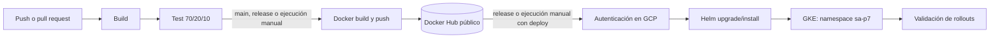
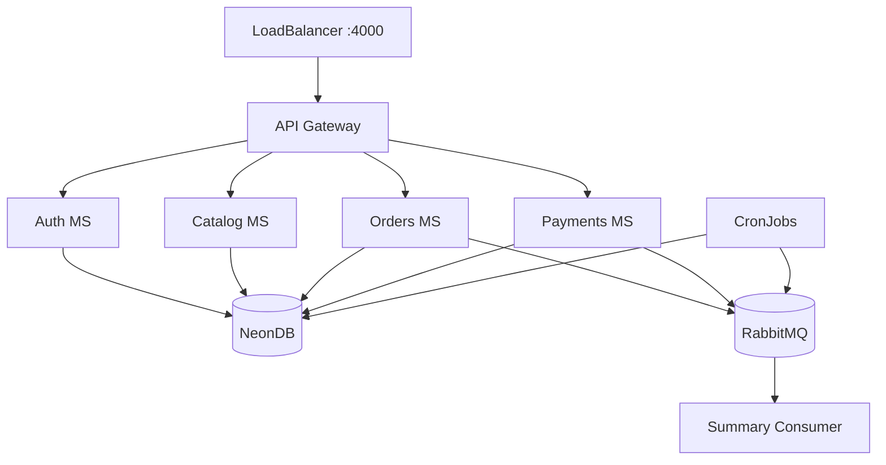

# Práctica 7 - Integración y despliegue continuo

## 1. Objetivo

Automatizar la integración, validación, publicación y entrega del ecosistema de microservicios desarrollado en las prácticas anteriores. La solución utiliza GitHub Actions, Docker Hub, Helm y un clúster de Google Kubernetes Engine (GKE).

## 2. Arquitectura del pipeline

El workflow se encuentra en `.github/workflows/p7-ci-cd.yml` y separa el proceso en las cuatro fases solicitadas por el enunciado.



### Fase 1: Build

Una matriz compila `api-gateway`, `auth-ms` y `catalog-ms` con Go. También instala dependencias y valida la sintaxis de `orders-ms`, `payments-ms` y `scheduled-jobs` con Python. Si un componente no compila, las fases posteriores no se ejecutan.

### Fase 2: Test

Las pruebas se ejecutan en tres jobs independientes para que GitHub Actions muestre claramente el resultado y peso de cada categoría:

| Categoría | Archivos | Proporción | Propósito |
|---|---:|---:|---|
| Unitarias | 7 | 70% | Reglas de carrito, órdenes y pagos con dependencias aisladas |
| Integración | 2 | 20% | Colaboración de órdenes con catálogo, repositorio y mensajería |
| E2E | 1 | 10% | Contrato completo de imágenes y despliegue |

Cada caso se encuentra en un archivo independiente y usa nombres de pruebas, funciones y variables en español. `scripts/verificar_distribucion_pruebas.py` detiene el pipeline si falta una marca o si la relación deja de ser exactamente 7/2/1.

### Fase 3: Dockerización y publicación

Después de superar build y test, una matriz construye y publica seis imágenes en el repositorio público `jeremy142004/sa-p7`:

- `api-gateway`
- `auth-ms`
- `catalog-ms`
- `orders-ms`
- `payments-ms`
- `scheduled-jobs`

Cada imagen recibe dos etiquetas: `<servicio>-<SHA>` conserva una versión inmutable asociada al commit y `<servicio>-latest` facilita identificar la versión más reciente. Los pull requests validan el código, pero no publican imágenes.

### Fase 4: Despliegue en GKE

El job de despliegue se activa al publicar un release o mediante `workflow_dispatch` con la opción `deploy=true`. La Action se autentica con una cuenta de servicio, obtiene las credenciales del clúster y ejecuta `helm upgrade --install` en el namespace `sa-p7`.

El archivo privado de valores llega desde un GitHub Secret temporal, nunca se versiona y se elimina del runner al terminar. Helm toma las imágenes etiquetadas con el SHA exacto de la ejecución, actualiza los deployments y espera que todos sus rollouts estén disponibles.



## 3. Disparadores y versionamiento

| Evento | Build y test | Publicación | Despliegue |
|---|---|---|---|
| Pull request hacia `main` | Sí | No | No |
| Push a `main` | Sí | Sí | No |
| Push de un tag `v*` | Sí | Sí | Sí |
| Release publicado | Sí | Sí | Sí |
| Ejecución manual | Sí | Sí | Solo con `deploy=true` |

Los filtros de ruta evitan ejecuciones ajenas a P4, los CronJobs de P5, el chart de P6, P7 o el propio workflow. Un tag de versión como `v1.0.0` ejecuta el flujo completo hasta GKE. La combinación de la rama principal, releases, tags Git y tags Docker por SHA da trazabilidad entre código fuente, imagen y despliegue.

## 4. Configuración protegida

### GitHub Secrets

- `DOCKERHUB_USERNAME`: usuario que publica las imágenes.
- `DOCKERHUB_TOKEN`: token de acceso al registry.
- `GCP_SA_KEY`: JSON de la cuenta de servicio usada por GitHub Actions.
- `P7_VALUES_YAML`: valores privados de Helm con conexiones de NeonDB, JWT, cifrado y RabbitMQ.

### GitHub Variables

- `GCP_PROJECT_ID=sa-202300644`
- `GKE_CLUSTER=p7-202300644`
- `GKE_ZONE=us-central1-a`

Ningún token, contraseña, llave JSON ni URL privada de base de datos debe aparecer en el repositorio o en las capturas.

## 5. Ejecución local

```bash
cd P7
python -m pip install -r requirements-ci.txt
python scripts/verificar_distribucion_pruebas.py
pytest -m unit -v
pytest -m integration -v
pytest -m e2e -v
```

Las diez pruebas no requieren Docker. La construcción real de contenedores y el despliegue se validan en GitHub Actions y GKE.

## 6. Resultado comprobado

- Suite local: 10 de 10 pruebas aprobadas y distribución 70/20/10 válida.
- Registry: repositorio público con imágenes de los cinco microservicios y `scheduled-jobs`.
- Helm: release `sa-platform`, chart `0.3.0`, estado `deployed` en `sa-p7`.
- Kubernetes: seis deployments disponibles, RabbitMQ operativo y cinco HPA con métricas.
- CronJobs: `execution-recorder` cada 2 minutos y `summary-publisher` cada 10 minutos, ambos con ejecuciones completadas.
- API pública: `GET /health` responde `{"estado":"ok","servicio":"api-gateway"}`.

## 7. Evidencias

Las capturas exigidas se almacenan en `P7/evidencias/`:

- `dockerhub-imagenes-publicadas.png`: repositorio público e imágenes publicadas.
- `github-actions-pipeline-exitoso.png`: ejecución completa del pipeline en Actions.
- `github-actions-pruebas.png`: jobs de pruebas unitarias, integración y E2E.
- `gke-cluster-desplegado.png`: detalles del clúster `p7-202300644`.
- `gke-cargas-trabajo.png`: microservicios, RabbitMQ y CronJobs con estado correcto en `sa-p7`.
- `gke-cronjobs.png`: programación y últimas ejecuciones exitosas del CronJob.

## 8. Preguntas teóricas

### ¿Qué diferencia existe entre integración continua y despliegue continuo?

La integración continua valida cada cambio mediante build y pruebas automáticas. El despliegue continuo extiende ese control hasta publicar un artefacto probado en un ambiente. Separar ambas decisiones permite detectar errores pronto y proteger producción con disparadores o aprobaciones específicas.

### ¿Por qué las pruebas deben ejecutarse antes de construir y publicar imágenes?

Porque una imagen es un artefacto distribuible. Publicarla antes de validar el código permitiría que una versión defectuosa llegara al registry y quizá al clúster. La dependencia `needs: [build, test]` convierte la calidad en una condición obligatoria.

### ¿Por qué usar etiquetas por SHA además de `latest`?

`latest` es cómoda, pero cambia con cada publicación y no identifica de forma inequívoca el código desplegado. El SHA es inmutable y permite auditoría, reproducción y rollback. En este pipeline GKE recibe precisamente la imagen del commit que superó las validaciones.

### ¿Qué función cumple Helm en el despliegue?

Helm agrupa los manifiestos de Kubernetes, parámetros y dependencias en un chart versionado. `upgrade --install` hace el proceso repetible e idempotente: instala la primera versión o actualiza la existente sin mantener comandos distintos para cada recurso.

### ¿Cómo se protegen las credenciales del pipeline?

Los datos sensibles se almacenan como GitHub Secrets cifrados y solo se inyectan al job que los necesita. El runner crea el archivo privado de Helm en su carpeta temporal y lo elimina al finalizar. Las variables no sensibles, como proyecto, clúster y zona, se mantienen separadas como GitHub Variables.

### ¿Qué evita que un cambio no validado llegue a GKE?

El job Docker depende de build y test; a su vez, deploy depende de que todas las imágenes se hayan publicado. Además, el despliegue solo se habilita con un release o una ejecución manual explícita. Esta cadena conserva el mismo SHA desde el commit hasta los pods.
