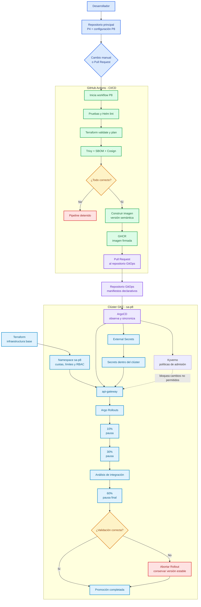
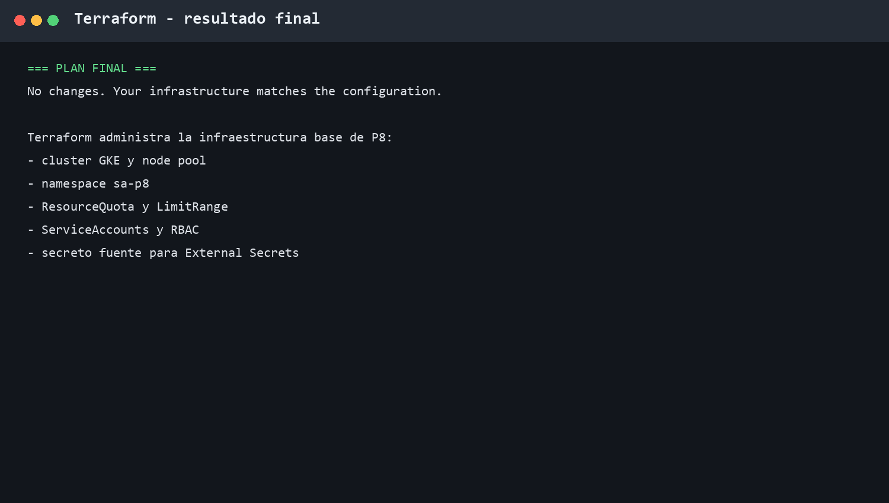
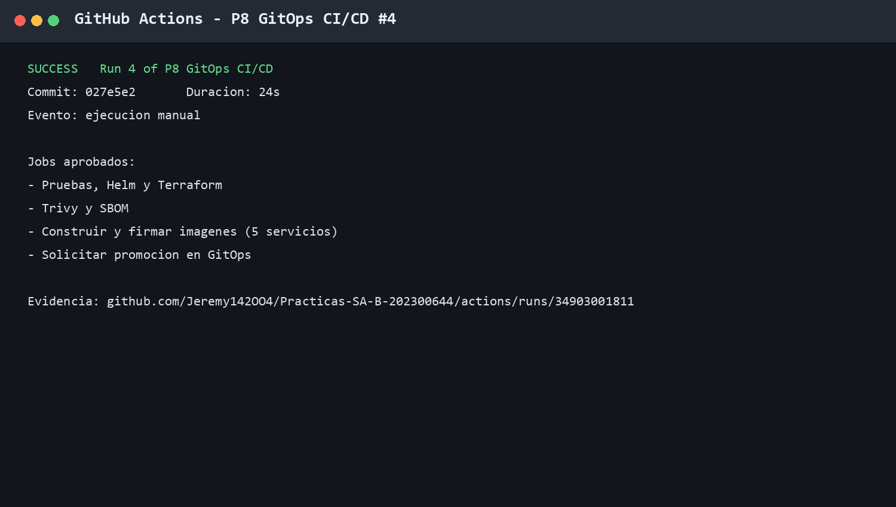
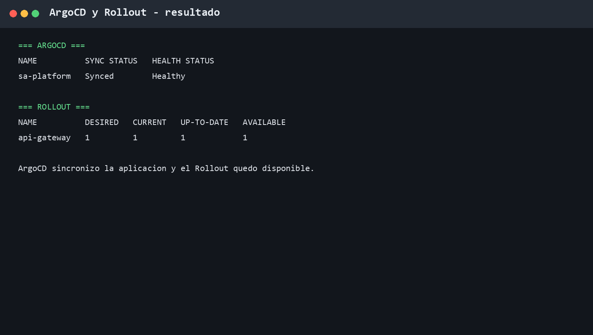
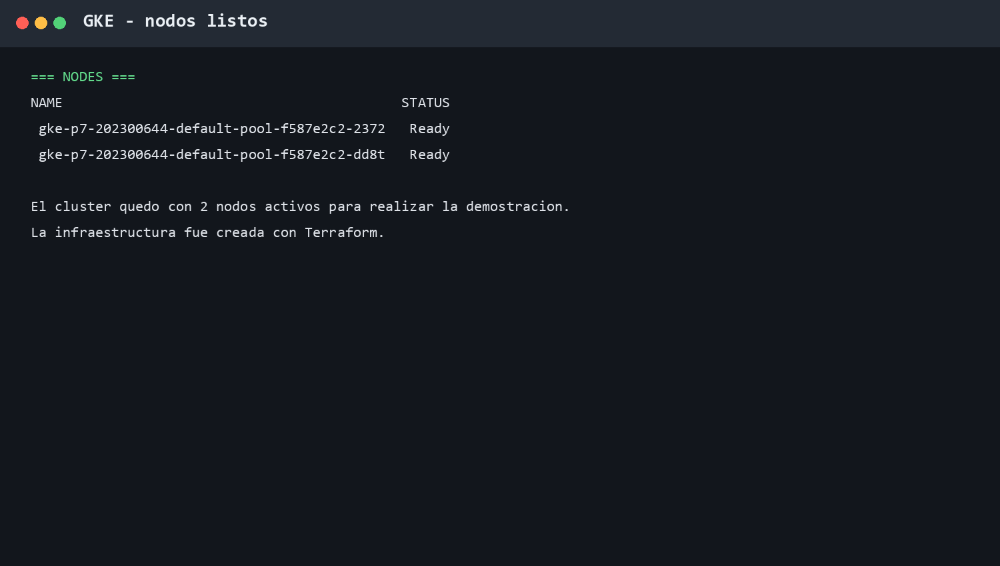
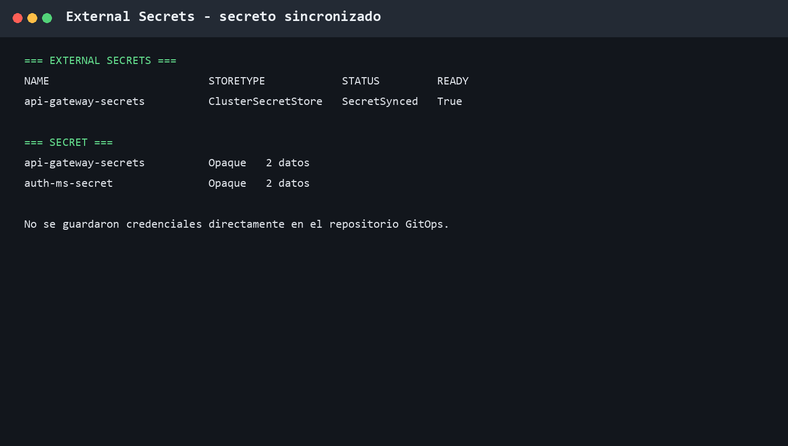
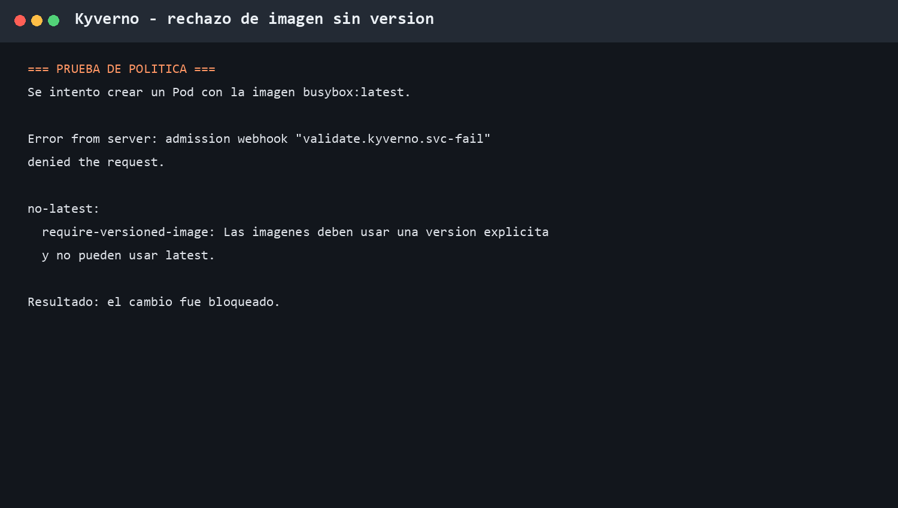
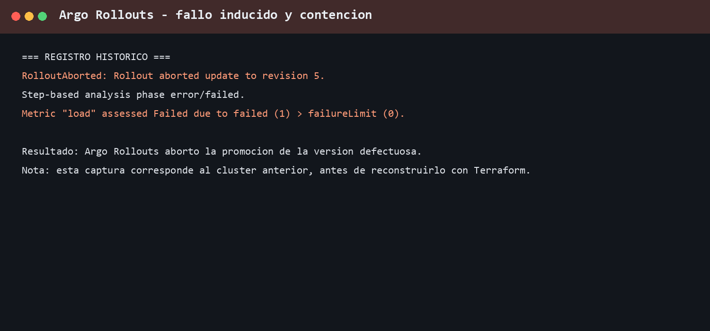

# Práctica 8 - GitOps, canary y seguridad

## 1. Objetivo

En esta práctica se pasó el despliegue a GitOps. GitHub Actions valida el
código y crea las imágenes. El repositorio GitOps guarda los manifiestos. ArgoCD
lee ese repositorio y los aplica en GKE. Argo Rollouts mueve el tráfico poco a
poco.

La práctica usa los microservicios de las prácticas anteriores sin copiarlos.
P8 agrega la infraestructura, la seguridad, el flujo GitOps y la documentación.

## 2. Qué se reutilizó

| Elemento | Ubicación original |
|---|---|
| Microservicios y Dockerfiles | `P4/` |
| Chart Helm y subcharts | `P6/charts/sa-platform/` |
| Pruebas unitarias e integración | `P7/tests/` |
| Verificador de pruebas | `P7/scripts/verificar_distribucion_pruebas.py` |

No se copiaron estas carpetas dentro de P8. Los archivos de P8 solo las
referencian cuando hace falta.

## 3. Flujo de la solución



El flujo actual conserva solo la validación de integración. Las pruebas de humo
y carga fueron retiradas por indicación del auxiliar.

El detalle del flujo se encuentra en [docs/FLUJO_GITOPS.md](docs/FLUJO_GITOPS.md).

## 4. Infraestructura con Terraform

Terraform creó la infraestructura base. No se creó el namespace ni las reglas
principales a mano.

Se administran estos recursos:

- Clúster GKE zonal `p7-202300644` en `us-central1-a`.
- Node pool con 2 nodos para la demostración.
- Namespace `sa-p8`.
- `ResourceQuota` y `LimitRange`.
- Cuentas de servicio y permisos mínimos.
- Secret fuente usado por External Secrets.

Resultado final de Terraform:



El mensaje `No changes` confirma que la infraestructura del clúster coincide con
los archivos de Terraform.

## 5. CI/CD de P8

El workflow está en `.github/workflows/p8-ci.yml` y se ejecuta manualmente para
no gastar ejecuciones mientras se trabaja.

El pipeline realiza estas tareas:

1. Ejecuta las pruebas.
2. Valida el chart con Helm.
3. Valida Terraform.
4. Revisa vulnerabilidades con Trivy.
5. Genera el SBOM.
6. Construye las imágenes.
7. Firma las imágenes con Cosign.
8. Solicita la promoción en el repositorio GitOps.

El workflow no usa `kubectl apply`, `kubectl set image` ni `helm upgrade` contra
el clúster. El despliegue lo realiza ArgoCD.



La ejecución aprobada fue la [P8 GitOps CI/CD #4](https://github.com/Jeremy142OO4/Practicas-SA-B-202300644/actions/runs/34903001811).
En esa ejecución pasaron las pruebas, Helm, Terraform, Trivy, SBOM, build,
firma y solicitud de promoción.

## 6. Repositorio GitOps y ArgoCD

El repositorio usado para los manifiestos es:

<https://github.com/Jeremy142OO4/Practicas-SA-B-202300644-gitops>

Contiene únicamente manifiestos, Rollouts, análisis, políticas y referencias a
secretos. ArgoCD observa la rama `main` y mantiene la aplicación
`sa-platform`.



Resultado comprobado:

| Recurso | Resultado |
|---|---|
| Aplicación ArgoCD | `Synced` y `Healthy` |
| Revisión actual | `0be810a` |
| Rollout `api-gateway` | 1 disponible de 1 |
| Pods de `sa-p8` | En ejecución |

## 7. Despliegue canary

El Rollout de `api-gateway` usa tres porcentajes de tráfico:

| Paso | Tráfico | Validación |
|---|---:|---|
| 1 | 10% | Pausa de observación |
| 2 | 30% | Integración, 2 comprobaciones |
| 3 | 60% | Pausa final de observación |

Entre los pasos hay pausas. Si una validación falla, Argo Rollouts detiene la
promoción y conserva la versión estable.

Las pruebas de humo y carga fueron retiradas porque el auxiliar indicó que ya no
se realizan. Se conserva únicamente la validación de integración. Esto evita
gastar recursos del clúster y no cambia el flujo de GitOps.




## 8. Secretos

Las credenciales no se guardan en texto plano en GitOps. External Secrets toma
los valores desde el SecretStore y crea los Secrets dentro de `sa-p8`.



Resultado comprobado:

- `api-gateway-secrets`: `SecretSynced` y `Ready=True`.
- `api-gateway-secrets`: 2 datos internos.
- `auth-ms-secret`: 2 datos internos.

Los archivos `.env`, tokens y valores privados permanecen fuera del repositorio.

## 9. Seguridad

Se agregaron políticas Kyverno para:

- Evitar imágenes con la etiqueta `latest`.
- Exigir usuario sin privilegios.
- Exigir recursos de CPU y memoria.
- Verificar la firma Cosign de las imágenes de GHCR.

La prueba de Kyverno se hizo con un Pod temporal que usaba `busybox:latest`.
El admission webhook lo rechazó y el Pod no fue creado.



## 10. Resultado comprobado


```text
ArgoCD:       Synced / Healthy
GKE:          2 nodos Ready
api-gateway:  1 réplica disponible
Secret:       SecretSynced / Ready=True
Kyverno:      políticas Ready y en modo Enforce
```

## 11. Evidencia del fallo controlado

Durante las pruebas anteriores se provocó un fallo en un análisis canary. La
promoción fue abortada porque el valor observado superó el límite configurado.
Ese análisis pertenece al flujo anterior y no forma parte de la configuración
actual.
Ese registro pertenece al clúster anterior, antes de reconstruir la
infraestructura con Terraform, y se conserva como evidencia del comportamiento
de contención.



El informe completo está en [docs/INFORME_INCIDENTE.md](docs/INFORME_INCIDENTE.md).

## 12. Tabla de enlaces de entrega

| Elemento | Enlace o ubicación |
|---|---|
| Código y documentación | [Repositorio principal](https://github.com/Jeremy142OO4/Practicas-SA-B-202300644) |
| Workflow P8 | [p8-ci.yml](https://github.com/Jeremy142OO4/Practicas-SA-B-202300644/blob/main/.github/workflows/p8-ci.yml) |
| Ejecución aprobada | [Actions #4](https://github.com/Jeremy142OO4/Practicas-SA-B-202300644/actions/runs/34903001811) |
| Repositorio GitOps | [Practicas-SA-B-202300644-gitops](https://github.com/Jeremy142OO4/Practicas-SA-B-202300644-gitops) |
| Configuración ArgoCD | [application.yaml](https://github.com/Jeremy142OO4/Practicas-SA-B-202300644-gitops/blob/main/argocd/application.yaml) |
| Rollout canary | [api-gateway-rollout.yaml](https://github.com/Jeremy142OO4/Practicas-SA-B-202300644-gitops/blob/main/rollouts/api-gateway-rollout.yaml) |
| Políticas Kyverno | [policies/](https://github.com/Jeremy142OO4/Practicas-SA-B-202300644-gitops/tree/main/policies) |
| Informe de incidente | [docs/INFORME_INCIDENTE.md](docs/INFORME_INCIDENTE.md) |
| Capturas | [P8/evidencias](evidencias/) |
| Video | Pendiente de grabar antes de entregar |

## 13. Comandos para comprobar el resultado

```bash
gcloud container clusters get-credentials p7-202300644 \
  --zone us-central1-a \
  --project sa-202300644

kubectl get nodes -o wide
kubectl get application sa-platform -n argocd
kubectl get rollout api-gateway -n sa-p8
kubectl get pods -n sa-p8
kubectl get externalsecret,secret -n sa-p8
```

## 14. Costo y apagado de nodos

Durante las pruebas se dejaron 2 nodos. Para bajarlos a 0:

```bash
gcloud container clusters resize p7-202300644 \
  --node-pool default-pool \
  --num-nodes 0 \
  --zone us-central1-a \
  --project sa-202300644 \
  --quiet
```

Se debe esperar a que la operación termine en estado `DONE`. Para volver a 2:

```bash
gcloud container clusters resize p7-202300644 \
  --node-pool default-pool \
  --num-nodes 2 \
  --zone us-central1-a \
  --project sa-202300644 \
  --quiet
```

Para revisar la operación si tarda:

```bash
gcloud container operations list \
  --zone us-central1-a \
  --project sa-202300644
```

## 15. Documentos de apoyo

- [Flujo GitOps](docs/FLUJO_GITOPS.md)
- [Informe de incidente](docs/INFORME_INCIDENTE.md)
- [Reutilización sin duplicar código](docs/REUTILIZACION.md)
- [Pruebas](tests/README.md)
- [Terraform](terraform/README.md)
- [Helm](helm/README.md)

## 16. Respuestas rápidas

### ¿Por qué ArgoCD es el que despliega?

Porque el repositorio GitOps es la fuente de verdad. Así el pipeline no necesita
acceso directo al clúster y cada cambio queda guardado en Git.

### ¿Por qué no se usa `latest`?

Porque puede cambiar sin avisar. Una versión como `v1.0.0` permite saber qué
imagen se probó y facilita regresar a una versión anterior.

### ¿Para qué sirve firmar la imagen?

Para comprobar que la imagen fue creada por el workflow esperado y no por otra
fuente.

### ¿Qué pasa si falla un análisis?

Argo Rollouts detiene la promoción. La versión estable continúa atendiendo el
servicio y el cambio defectuoso no avanza al siguiente porcentaje.
