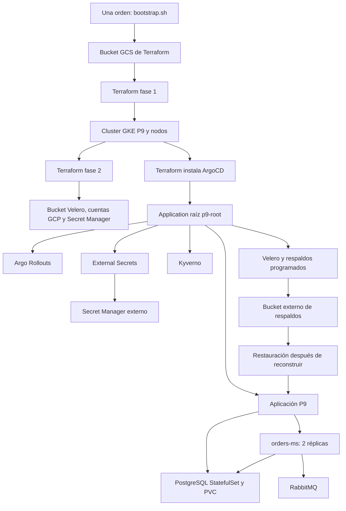

# Diagrama de la Práctica 9

El repositorio de código reutiliza la infraestructura de `P8/terraform` como
módulo. El repositorio GitOps reutiliza los charts y manifiestos de P8 mediante
referencias remotas; P9 solo agrega los recursos de continuidad operativa.
